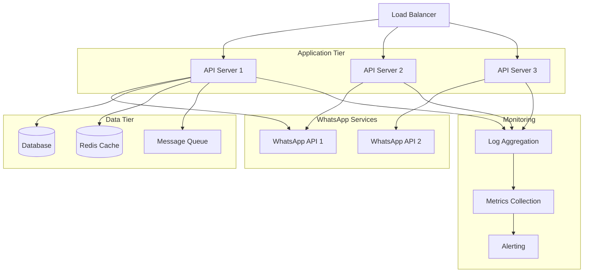

## Overview

This guide provides comprehensive best practices for deploying and maintaining WhatsApp API applications in production environments. Following these guidelines will help ensure reliability, security, and scalability of your implementation.

## Architecture Best Practices

### Production Architecture



### Deployment Patterns

#### Multi-Instance Deployment

```yaml
# docker-compose.production.yml
version: '3.8'

services:
  whatsapp-api:
    image: whatsapp-api:latest
    deploy:
      replicas: 3
      restart_policy:
        condition: on-failure
        max_attempts: 3
    environment:
      - PORT=3000
      - DB_HOST=postgres
      - REDIS_HOST=redis
      - SESSION_STORE=redis
    networks:
      - app-network
    volumes:
      - ./config:/app/config
      - ./logs:/app/logs
    healthcheck:
      test: ["CMD", "curl", "-f", "http://localhost:3000/health"]
      interval: 30s
      timeout: 10s
      retries: 3

  nginx:
    image: nginx:alpine
    ports:
      - "80:80"
      - "443:443"
    volumes:
      - ./nginx.conf:/etc/nginx/nginx.conf
      - ./ssl:/etc/nginx/ssl
    depends_on:
      - whatsapp-api
    networks:
      - app-network

  postgres:
    image: postgres:14
    environment:
      POSTGRES_DB: whatsapp_db
      POSTGRES_USER: whatsapp
      POSTGRES_PASSWORD: ${DB_PASSWORD}
    volumes:
      - postgres_data:/var/lib/postgresql/data
    networks:
      - app-network

  redis:
    image: redis:7-alpine
    command: redis-server --appendonly yes
    volumes:
      - redis_data:/data
    networks:
      - app-network

volumes:
  postgres_data:
  redis_data:

networks:
  app-network:
    driver: bridge
```

#### Kubernetes Deployment

```yaml
# whatsapp-api-deployment.yaml
apiVersion: apps/v1
kind: Deployment
metadata:
  name: whatsapp-api
  labels:
    app: whatsapp-api
spec:
  replicas: 3
  selector:
    matchLabels:
      app: whatsapp-api
  template:
    metadata:
      labels:
        app: whatsapp-api
    spec:
      containers:
      - name: whatsapp-api
        image: whatsapp-api:v1.0.0
        ports:
        - containerPort: 3000
        env:
        - name: DB_HOST
          value: "postgres-service"
        - name: REDIS_HOST
          value: "redis-service"
        - name: SESSION_STORE
          value: "redis"
        resources:
          requests:
            memory: "512Mi"
            cpu: "250m"
          limits:
            memory: "1Gi"
            cpu: "500m"
        livenessProbe:
          httpGet:
            path: /health
            port: 3000
          initialDelaySeconds: 30
          periodSeconds: 10
        readinessProbe:
          httpGet:
            path: /ready
            port: 3000
          initialDelaySeconds: 5
          periodSeconds: 5
        volumeMounts:
        - name: config-volume
          mountPath: /app/config
        - name: logs-volume
          mountPath: /app/logs
      volumes:
      - name: config-volume
        configMap:
          name: whatsapp-config
      - name: logs-volume
        persistentVolumeClaim:
          claimName: logs-pvc
---
apiVersion: v1
kind: Service
metadata:
  name: whatsapp-api-service
spec:
  selector:
    app: whatsapp-api
  ports:
    - protocol: TCP
      port: 80
      targetPort: 3000
  type: LoadBalancer
```

## Security Best Practices

### Environment Configuration

```bash
# .env.production
# Database Configuration
DB_HOST=postgres.internal
DB_PORT=5432
DB_NAME=whatsapp_production
DB_USER=whatsapp_user
DB_PASSWORD=${DB_PASSWORD_SECRET}
DB_SSL_MODE=require
DB_CONNECTION_POOL_MIN=5
DB_CONNECTION_POOL_MAX=20

# Redis Configuration
REDIS_HOST=redis.internal
REDIS_PORT=6379
REDIS_PASSWORD=${REDIS_PASSWORD_SECRET}
REDIS_DB=0
REDIS_TLS=true

# API Configuration
PORT=3000
API_KEY=${API_KEY_SECRET}
WEBHOOK_SECRET=${WEBHOOK_SECRET}
SESSION_SECRET=${SESSION_SECRET}

# Security
ALLOWED_ORIGINS=https://yourdomain.com,https://api.yourdomain.com
RATE_LIMIT_WINDOW_MS=60000
RATE_LIMIT_MAX_REQUESTS=100
ENABLE_HTTPS=true
SSL_CERT_PATH=/etc/ssl/certs/server.crt
SSL_KEY_PATH=/etc/ssl/private/server.key

# Monitoring
LOG_LEVEL=info
LOG_FORMAT=json
METRICS_ENABLED=true
HEALTH_CHECK_ENABLED=true

# WhatsApp Specific
MAX_MESSAGE_LENGTH=4096
MAX_MEDIA_SIZE=16777216
SESSION_TIMEOUT=3600
AUTO_RECONNECT=true
WEBHOOK_RETRY_ATTEMPTS=3
```

### Security Headers and Middleware

```javascript
const express = require('express');
const helmet = require('helmet');
const rateLimit = require('express-rate-limit');
const cors = require('cors');

const app = express();

// Security headers
app.use(helmet({
  contentSecurityPolicy: {
    directives: {
      defaultSrc: ["'self'"],
      styleSrc: ["'self'", "'unsafe-inline'"],
      scriptSrc: ["'self'"],
      imgSrc: ["'self'", "data:", "https:"],
    }
  },
  hsts: {
    maxAge: 31536000,
    includeSubDomains: true,
    preload: true
  }
}));

// CORS configuration
const corsOptions = {
  origin: function (origin, callback) {
    const allowedOrigins = process.env.ALLOWED_ORIGINS?.split(',') || [];
    if (!origin || allowedOrigins.includes(origin)) {
      callback(null, true);
    } else {
      callback(new Error('Not allowed by CORS'));
    }
  },
  credentials: true,
  optionsSuccessStatus: 200
};
app.use(cors(corsOptions));

// Rate limiting
const generalLimiter = rateLimit({
  windowMs: parseInt(process.env.RATE_LIMIT_WINDOW_MS) || 60000,
  max: parseInt(process.env.RATE_LIMIT_MAX_REQUESTS) || 100,
  message: 'Too many requests from this IP',
  standardHeaders: true,
  legacyHeaders: false
});
app.use(generalLimiter);

// API-specific rate limiting
const apiLimiter = rateLimit({
  windowMs: 60000, // 1 minute
  max: 50, // More restrictive for API endpoints
  message: 'API rate limit exceeded'
});
app.use('/send', apiLimiter);
app.use('/group', apiLimiter);

// Input validation middleware
const { body, validationResult } = require('express-validator');

const validateMessage = [
  body('phone').isMobilePhone().withMessage('Valid phone number required'),
  body('message').isLength({ min: 1, max: 4096 }).withMessage('Message length invalid'),
  (req, res, next) => {
    const errors = validationResult(req);
    if (!errors.isEmpty()) {
      return res.status(400).json({ errors: errors.array() });
    }
    next();
  }
];

app.post('/send/message', validateMessage, sendMessageHandler);
```

### Authentication and Authorization

```javascript
const jwt = require('jsonwebtoken');
const bcrypt = require('bcrypt');

class AuthenticationManager {
  constructor() {
    this.jwtSecret = process.env.JWT_SECRET;
    this.tokenExpiry = process.env.TOKEN_EXPIRY || '24h';
  }
  
  generateToken(payload) {
    return jwt.sign(payload, this.jwtSecret, { 
      expiresIn: this.tokenExpiry,
      issuer: 'whatsapp-api',
      audience: 'api-clients'
    });
  }
  
  verifyToken(token) {
    try {
      return jwt.verify(token, this.jwtSecret);
    } catch (error) {
      throw new Error('Invalid token');
    }
  }
  
  async hashPassword(password) {
    const saltRounds = 12;
    return await bcrypt.hash(password, saltRounds);
  }
  
  async verifyPassword(password, hash) {
    return await bcrypt.compare(password, hash);
  }
}

// Authentication middleware
const authenticate = (req, res, next) => {
  const authHeader = req.headers.authorization;
  
  if (!authHeader || !authHeader.startsWith('Bearer ')) {
    return res.status(401).json({ error: 'Authentication required' });
  }
  
  const token = authHeader.substring(7);
  
  try {
    const auth = new AuthenticationManager();
    const decoded = auth.verifyToken(token);
    req.user = decoded;
    next();
  } catch (error) {
    return res.status(401).json({ error: 'Invalid token' });
  }
};

// Authorization middleware
const authorize = (permissions) => {
  return (req, res, next) => {
    if (!req.user || !req.user.permissions) {
      return res.status(403).json({ error: 'Insufficient permissions' });
    }
    
    const hasPermission = permissions.some(permission => 
      req.user.permissions.includes(permission)
    );
    
    if (!hasPermission) {
      return res.status(403).json({ error: 'Access denied' });
    }
    
    next();
  };
};

// Usage
app.use('/api', authenticate);
app.post('/send/message', authorize(['send_messages']), sendMessageHandler);
app.post('/group', authorize(['manage_groups']), createGroupHandler);
```

## Performance Optimization

### Database Optimization

```sql
-- Optimized database schema
CREATE TABLE whatsapp_sessions (
    id VARCHAR(255) PRIMARY KEY,
    device_name VARCHAR(255),
    device_id VARCHAR(255),
    connected_at TIMESTAMP DEFAULT CURRENT_TIMESTAMP,
    last_activity TIMESTAMP DEFAULT CURRENT_TIMESTAMP,
    session_data JSONB,
    status VARCHAR(50) DEFAULT 'active',
    created_at TIMESTAMP DEFAULT CURRENT_TIMESTAMP,
    updated_at TIMESTAMP DEFAULT CURRENT_TIMESTAMP
);

CREATE INDEX idx_sessions_status ON whatsapp_sessions(status);
CREATE INDEX idx_sessions_last_activity ON whatsapp_sessions(last_activity);
CREATE INDEX idx_sessions_device_id ON whatsapp_sessions(device_id);

CREATE TABLE message_logs (
    id BIGSERIAL PRIMARY KEY,
    message_id VARCHAR(255) UNIQUE,
    session_id VARCHAR(255),
    phone VARCHAR(20),
    message_type VARCHAR(50),
    status VARCHAR(50),
    created_at TIMESTAMP DEFAULT CURRENT_TIMESTAMP,
    sent_at TIMESTAMP,
    delivered_at TIMESTAMP,
    read_at TIMESTAMP
);

CREATE INDEX idx_message_logs_session_id ON message_logs(session_id);
CREATE INDEX idx_message_logs_phone ON message_logs(phone);
CREATE INDEX idx_message_logs_status ON message_logs(status);
CREATE INDEX idx_message_logs_created_at ON message_logs(created_at);

-- Partitioning for large tables
CREATE TABLE message_logs_2024_01 PARTITION OF message_logs
    FOR VALUES FROM ('2024-01-01') TO ('2024-02-01');
```

### Caching Strategy

```javascript
const Redis = require('ioredis');

class CacheManager {
  constructor() {
    this.redis = new Redis({
      host: process.env.REDIS_HOST,
      port: process.env.REDIS_PORT,
      password: process.env.REDIS_PASSWORD,
      retryDelayOnFailover: 100,
      maxRetriesPerRequest: 3,
      lazyConnect: true
    });
    
    this.defaultTTL = 3600; // 1 hour
  }
  
  async get(key) {
    try {
      const data = await this.redis.get(key);
      return data ? JSON.parse(data) : null;
    } catch (error) {
      console.error('Cache get error:', error);
      return null;
    }
  }
  
  async set(key, value, ttl = this.defaultTTL) {
    try {
      await this.redis.setex(key, ttl, JSON.stringify(value));
    } catch (error) {
      console.error('Cache set error:', error);
    }
  }
  
  async del(key) {
    try {
      await this.redis.del(key);
    } catch (error) {
      console.error('Cache delete error:', error);
    }
  }
  
  async invalidatePattern(pattern) {
    try {
      const keys = await this.redis.keys(pattern);
      if (keys.length > 0) {
        await this.redis.del(...keys);
      }
    } catch (error) {
      console.error('Cache invalidation error:', error);
    }
  }
}

// Cache middleware
const cache = new CacheManager();

const cacheMiddleware = (ttl = 300) => {
  return async (req, res, next) => {
    const cacheKey = `api:${req.method}:${req.originalUrl}:${JSON.stringify(req.body)}`;
    
    try {
      const cachedResponse = await cache.get(cacheKey);
      if (cachedResponse) {
        return res.json(cachedResponse);
      }
      
      // Store original json method
      const originalJson = res.json;
      res.json = function(data) {
        // Cache successful responses
        if (res.statusCode === 200) {
          cache.set(cacheKey, data, ttl);
        }
        originalJson.call(this, data);
      };
      
      next();
    } catch (error) {
      console.error('Cache middleware error:', error);
      next();
    }
  };
};

// Usage
app.get('/group/info', cacheMiddleware(600), getGroupInfoHandler);
app.get('/user/check', cacheMiddleware(1800), checkUserHandler);
```

### Connection Pooling

```javascript
const { Pool } = require('pg');

class DatabaseManager {
  constructor() {
    this.pool = new Pool({
      host: process.env.DB_HOST,
      port: process.env.DB_PORT,
      database: process.env.DB_NAME,
      user: process.env.DB_USER,
      password: process.env.DB_PASSWORD,
      ssl: process.env.DB_SSL_MODE === 'require' ? { rejectUnauthorized: false } : false,
      min: parseInt(process.env.DB_CONNECTION_POOL_MIN) || 5,
      max: parseInt(process.env.DB_CONNECTION_POOL_MAX) || 20,
      idleTimeoutMillis: 30000,
      connectionTimeoutMillis: 2000,
    });
    
    this.pool.on('error', (err) => {
      console.error('Database pool error:', err);
    });
  }
  
  async query(text, params) {
    const start = Date.now();
    const client = await this.pool.connect();
    
    try {
      const result = await client.query(text, params);
      const duration = Date.now() - start;
      
      console.log('Executed query', { 
        text: text.substring(0, 100),
        duration,
        rows: result.rowCount 
      });
      
      return result;
    } finally {
      client.release();
    }
  }
  
  async transaction(queries) {
    const client = await this.pool.connect();
    
    try {
      await client.query('BEGIN');
      
      const results = [];
      for (const { text, params } of queries) {
        const result = await client.query(text, params);
        results.push(result);
      }
      
      await client.query('COMMIT');
      return results;
    } catch (error) {
      await client.query('ROLLBACK');
      throw error;
    } finally {
      client.release();
    }
  }
  
  async close() {
    await this.pool.end();
  }
}
```

## Monitoring and Observability

### Comprehensive Logging

```javascript
const winston = require('winston');
const { ElasticsearchTransport } = require('winston-elasticsearch');

class Logger {
  constructor() {
    const transports = [
      new winston.transports.Console({
        format: winston.format.combine(
          winston.format.colorize(),
          winston.format.simple()
        )
      }),
      new winston.transports.File({
        filename: './logs/app.log',
        format: winston.format.json(),
        maxsize: 100 * 1024 * 1024, // 100MB
        maxFiles: 10
      })
    ];
    
    // Add Elasticsearch transport in production
    if (process.env.ELASTICSEARCH_URL) {
      transports.push(new ElasticsearchTransport({
        clientOpts: { node: process.env.ELASTICSEARCH_URL },
        index: 'whatsapp-api-logs'
      }));
    }
    
    this.logger = winston.createLogger({
      level: process.env.LOG_LEVEL || 'info',
      format: winston.format.combine(
        winston.format.timestamp(),
        winston.format.errors({ stack: true }),
        winston.format.json()
      ),
      defaultMeta: { 
        service: 'whatsapp-api',
        version: process.env.APP_VERSION 
      },
      transports
    });
  }
  
  info(message, meta = {}) {
    this.logger.info(message, meta);
  }
  
  error(message, meta = {}) {
    this.logger.error(message, meta);
  }
  
  warn(message, meta = {}) {
    this.logger.warn(message, meta);
  }
  
  debug(message, meta = {}) {
    this.logger.debug(message, meta);
  }
}

// Request logging middleware
const logger = new Logger();

const requestLogger = (req, res, next) => {
  const start = Date.now();
  
  res.on('finish', () => {
    const duration = Date.now() - start;
    
    logger.info('HTTP Request', {
      method: req.method,
      url: req.originalUrl,
      statusCode: res.statusCode,
      duration,
      userAgent: req.get('User-Agent'),
      ip: req.ip,
      requestId: req.headers['x-request-id']
    });
  });
  
  next();
};

app.use(requestLogger);
```

### Health Checks

```javascript
class HealthChecker {
  constructor(dependencies) {
    this.dependencies = dependencies;
  }
  
  async checkHealth() {
    const results = {
      status: 'healthy',
      timestamp: new Date().toISOString(),
      checks: {}
    };
    
    let isHealthy = true;
    
    for (const [name, checker] of Object.entries(this.dependencies)) {
      try {
        const start = Date.now();
        await checker.check();
        const duration = Date.now() - start;
        
        results.checks[name] = {
          status: 'healthy',
          duration
        };
      } catch (error) {
        isHealthy = false;
        results.checks[name] = {
          status: 'unhealthy',
          error: error.message
        };
      }
    }
    
    results.status = isHealthy ? 'healthy' : 'unhealthy';
    return results;
  }
}

// Health check endpoints
const healthChecker = new HealthChecker({
  database: {
    check: async () => {
      await db.query('SELECT 1');
    }
  },
  redis: {
    check: async () => {
      await cache.redis.ping();
    }
  },
  whatsapp: {
    check: async () => {
      const response = await fetch('http://localhost:3000/app/devices');
      if (!response.ok) throw new Error('WhatsApp API not responding');
    }
  }
});

app.get('/health', async (req, res) => {
  try {
    const health = await healthChecker.checkHealth();
    const statusCode = health.status === 'healthy' ? 200 : 503;
    res.status(statusCode).json(health);
  } catch (error) {
    res.status(503).json({
      status: 'unhealthy',
      error: error.message,
      timestamp: new Date().toISOString()
    });
  }
});

app.get('/ready', async (req, res) => {
  try {
    // Quick readiness check
    await db.query('SELECT 1');
    res.status(200).json({ status: 'ready' });
  } catch (error) {
    res.status(503).json({ status: 'not ready', error: error.message });
  }
});
```

### Metrics Collection

```javascript
const promClient = require('prom-client');

class MetricsCollector {
  constructor() {
    // Create a Registry which registers the metrics
    this.register = new promClient.Registry();
    
    // Add a default label which is added to all metrics
    this.register.setDefaultLabels({
      app: 'whatsapp-api'
    });
    
    // Enable the collection of default metrics
    promClient.collectDefaultMetrics({ register: this.register });
    
    // Create custom metrics
    this.httpRequestsTotal = new promClient.Counter({
      name: 'http_requests_total',
      help: 'Total number of HTTP requests',
      labelNames: ['method', 'route', 'status_code'],
      registers: [this.register]
    });
    
    this.httpRequestDuration = new promClient.Histogram({
      name: 'http_request_duration_seconds',
      help: 'Duration of HTTP requests in seconds',
      labelNames: ['method', 'route'],
      buckets: [0.1, 0.5, 1, 2, 5],
      registers: [this.register]
    });
    
    this.messagesTotal = new promClient.Counter({
      name: 'whatsapp_messages_total',
      help: 'Total number of messages processed',
      labelNames: ['type', 'status'],
      registers: [this.register]
    });
    
    this.sessionStatus = new promClient.Gauge({
      name: 'whatsapp_session_status',
      help: 'WhatsApp session status (1 = connected, 0 = disconnected)',
      registers: [this.register]
    });
  }
  
  recordHttpRequest(method, route, statusCode, duration) {
    this.httpRequestsTotal.inc({ method, route, status_code: statusCode });
    this.httpRequestDuration.observe({ method, route }, duration / 1000);
  }
  
  recordMessage(type, status) {
    this.messagesTotal.inc({ type, status });
  }
  
  updateSessionStatus(isConnected) {
    this.sessionStatus.set(isConnected ? 1 : 0);
  }
  
  getMetrics() {
    return this.register.metrics();
  }
}

const metrics = new MetricsCollector();

// Metrics middleware
const metricsMiddleware = (req, res, next) => {
  const start = Date.now();
  
  res.on('finish', () => {
    const duration = Date.now() - start;
    const route = req.route ? req.route.path : req.path;
    
    metrics.recordHttpRequest(
      req.method,
      route,
      res.statusCode,
      duration
    );
  });
  
  next();
};

app.use(metricsMiddleware);

// Metrics endpoint
app.get('/metrics', async (req, res) => {
  res.set('Content-Type', promClient.register.contentType);
  res.end(await metrics.getMetrics());
});
```

## Backup and Disaster Recovery

### Database Backup Strategy

```bash
#!/bin/bash
# backup.sh - Database backup script

BACKUP_DIR="/backups/whatsapp-db"
DB_NAME="whatsapp_production"
TIMESTAMP=$(date +%Y%m%d_%H%M%S)
BACKUP_FILE="$BACKUP_DIR/backup_$TIMESTAMP.sql"

# Create backup directory if it doesn't exist
mkdir -p $BACKUP_DIR

# Create database backup
pg_dump -h $DB_HOST -U $DB_USER -d $DB_NAME > $BACKUP_FILE

# Compress backup
gzip $BACKUP_FILE

# Upload to cloud storage (S3 example)
aws s3 cp $BACKUP_FILE.gz s3://whatsapp-backups/database/

# Cleanup old local backups (keep 7 days)
find $BACKUP_DIR -name "backup_*.sql.gz" -mtime +7 -delete

# Cleanup old cloud backups (keep 30 days)
aws s3 ls s3://whatsapp-backups/database/ --recursive | \
  awk '$1 < "'$(date -d '30 days ago' '+%Y-%m-%d')'" {print $4}' | \
  xargs -I {} aws s3 rm s3://whatsapp-backups/{}

echo "Backup completed: $BACKUP_FILE.gz"
```

### Session Backup

```javascript
class SessionBackupManager {
  constructor(options = {}) {
    this.backupInterval = options.backupInterval || 3600000; // 1 hour
    this.backupPath = options.backupPath || './backups/sessions';
    this.maxBackups = options.maxBackups || 24; // Keep 24 hours worth
    this.cloudStorage = options.cloudStorage;
  }
  
  start() {
    this.interval = setInterval(() => {
      this.performBackup();
    }, this.backupInterval);
    
    console.log('Session backup manager started');
  }
  
  stop() {
    if (this.interval) {
      clearInterval(this.interval);
      console.log('Session backup manager stopped');
    }
  }
  
  async performBackup() {
    try {
      const timestamp = new Date().toISOString().replace(/[:.]/g, '-');
      const backupFile = path.join(this.backupPath, `sessions_${timestamp}.json`);
      
      // Ensure backup directory exists
      await fs.mkdir(this.backupPath, { recursive: true });
      
      // Get all active sessions
      const sessions = await this.getAllSessions();
      
      // Write to file
      await fs.writeFile(backupFile, JSON.stringify(sessions, null, 2));
      
      console.log(`Session backup created: ${backupFile}`);
      
      // Upload to cloud storage if configured
      if (this.cloudStorage) {
        await this.cloudStorage.upload(backupFile);
      }
      
      // Cleanup old backups
      await this.cleanupOldBackups();
      
    } catch (error) {
      console.error('Session backup failed:', error);
    }
  }
  
  async getAllSessions() {
    const query = `
      SELECT id, device_name, device_id, session_data, last_activity
      FROM whatsapp_sessions 
      WHERE status = 'active'
    `;
    
    const result = await db.query(query);
    return result.rows;
  }
  
  async restoreFromBackup(backupFile) {
    try {
      const data = await fs.readFile(backupFile, 'utf8');
      const sessions = JSON.parse(data);
      
      for (const session of sessions) {
        await this.restoreSession(session);
      }
      
      console.log(`Restored ${sessions.length} sessions from backup`);
    } catch (error) {
      console.error('Session restore failed:', error);
      throw error;
    }
  }
  
  async restoreSession(sessionData) {
    const query = `
      INSERT INTO whatsapp_sessions (id, device_name, device_id, session_data, last_activity, status)
      VALUES ($1, $2, $3, $4, $5, 'active')
      ON CONFLICT (id) DO UPDATE SET
        session_data = EXCLUDED.session_data,
        last_activity = EXCLUDED.last_activity,
        status = EXCLUDED.status
    `;
    
    await db.query(query, [
      sessionData.id,
      sessionData.device_name,
      sessionData.device_id,
      sessionData.session_data,
      sessionData.last_activity
    ]);
  }
  
  async cleanupOldBackups() {
    const files = await fs.readdir(this.backupPath);
    const backupFiles = files
      .filter(file => file.startsWith('sessions_') && file.endsWith('.json'))
      .sort()
      .reverse();
    
    // Remove old backups
    for (let i = this.maxBackups; i < backupFiles.length; i++) {
      const filePath = path.join(this.backupPath, backupFiles[i]);
      await fs.unlink(filePath);
      console.log(`Removed old backup: ${backupFiles[i]}`);
    }
  }
}
```

## Deployment Automation

### CI/CD Pipeline

```yaml
# .github/workflows/deploy.yml
name: Deploy WhatsApp API

on:
  push:
    branches: [main]
  release:
    types: [published]

jobs:
  test:
    runs-on: ubuntu-latest
    steps:
      - uses: actions/checkout@v3
      
      - name: Setup Node.js
        uses: actions/setup-node@v3
        with:
          node-version: '18'
          cache: 'npm'
      
      - name: Install dependencies
        run: npm ci
      
      - name: Run tests
        run: npm test
      
      - name: Run linting
        run: npm run lint
      
      - name: Security audit
        run: npm audit --audit-level moderate

  build:
    needs: test
    runs-on: ubuntu-latest
    steps:
      - uses: actions/checkout@v3
      
      - name: Set up Docker Buildx
        uses: docker/setup-buildx-action@v2
      
      - name: Login to Container Registry
        uses: docker/login-action@v2
        with:
          registry: ghcr.io
          username: ${{ github.actor }}
          password: ${{ secrets.GITHUB_TOKEN }}
      
      - name: Build and push Docker image
        uses: docker/build-push-action@v4
        with:
          context: .
          push: true
          tags: |
            ghcr.io/${{ github.repository }}:latest
            ghcr.io/${{ github.repository }}:${{ github.sha }}

  deploy:
    needs: build
    runs-on: ubuntu-latest
    environment: production
    steps:
      - uses: actions/checkout@v3
      
      - name: Deploy to Kubernetes
        run: |
          echo "${{ secrets.KUBECONFIG }}" | base64 -d > kubeconfig
          export KUBECONFIG=kubeconfig
          
          # Update image tag in deployment
          sed -i "s|whatsapp-api:.*|whatsapp-api:${{ github.sha }}|" k8s/deployment.yaml
          
          # Apply configuration
          kubectl apply -f k8s/
          
          # Wait for deployment to complete
          kubectl rollout status deployment/whatsapp-api
```

### Production Checklist

<AccordionGroup>
  <Accordion icon="check" title="Security Checklist">
    - [ ] All secrets stored in environment variables
    - [ ] HTTPS enabled with valid SSL certificates
    - [ ] Authentication and authorization implemented
    - [ ] Rate limiting configured
    - [ ] Input validation on all endpoints
    - [ ] Security headers configured
    - [ ] Database connections secured with SSL
    - [ ] Access logs enabled and monitored
  </Accordion>
  
  <Accordion icon="check" title="Performance Checklist">
    - [ ] Database queries optimized with indexes
    - [ ] Connection pooling configured
    - [ ] Caching strategy implemented
    - [ ] CDN configured for static assets
    - [ ] Gzip compression enabled
    - [ ] Resource limits configured
    - [ ] Load balancing implemented
    - [ ] Auto-scaling configured
  </Accordion>
  
  <Accordion icon="check" title="Reliability Checklist">
    - [ ] Health checks implemented
    - [ ] Graceful shutdown handling
    - [ ] Error handling and retry logic
    - [ ] Circuit breakers implemented
    - [ ] Session persistence configured
    - [ ] Backup strategy implemented
    - [ ] Disaster recovery plan documented
    - [ ] Monitoring and alerting configured
  </Accordion>
  
  <Accordion icon="check" title="Monitoring Checklist">
    - [ ] Application logs centralized
    - [ ] Metrics collection configured
    - [ ] Performance monitoring setup
    - [ ] Error tracking implemented
    - [ ] Uptime monitoring configured
    - [ ] Alert thresholds defined
    - [ ] Dashboards created
    - [ ] On-call procedures documented
  </Accordion>
</AccordionGroup>

## Maintenance and Updates

### Regular Maintenance Tasks

```bash
#!/bin/bash
# maintenance.sh - Regular maintenance tasks

# 1. Database maintenance
echo "Running database maintenance..."
psql -h $DB_HOST -U $DB_USER -d $DB_NAME -c "VACUUM ANALYZE;"
psql -h $DB_HOST -U $DB_USER -d $DB_NAME -c "REINDEX DATABASE $DB_NAME;"

# 2. Log rotation and cleanup
echo "Cleaning up logs..."
find /app/logs -name "*.log" -mtime +30 -delete
find /app/logs -name "*.log.*" -mtime +7 -delete

# 3. Session cleanup
echo "Cleaning up inactive sessions..."
psql -h $DB_HOST -U $DB_USER -d $DB_NAME -c "
  DELETE FROM whatsapp_sessions 
  WHERE status = 'inactive' 
  AND last_activity < NOW() - INTERVAL '7 days';
"

# 4. Cache cleanup
echo "Cleaning up Redis cache..."
redis-cli -h $REDIS_HOST -p $REDIS_PORT FLUSHDB

# 5. Container cleanup (if using Docker)
echo "Cleaning up Docker..."
docker system prune -f

echo "Maintenance completed"
```

### Update Strategy

```javascript
class UpdateManager {
  constructor() {
    this.currentVersion = process.env.APP_VERSION;
    this.updateCheckInterval = 24 * 60 * 60 * 1000; // 24 hours
  }
  
  async checkForUpdates() {
    try {
      const response = await fetch('https://api.github.com/repos/your-org/whatsapp-api/releases/latest');
      const release = await response.json();
      
      const latestVersion = release.tag_name;
      
      if (this.isNewerVersion(latestVersion, this.currentVersion)) {
        console.log(`New version available: ${latestVersion} (current: ${this.currentVersion})`);
        await this.notifyUpdate(latestVersion, release);
        return true;
      }
      
      return false;
    } catch (error) {
      console.error('Failed to check for updates:', error);
      return false;
    }
  }
  
  isNewerVersion(latest, current) {
    const latestParts = latest.replace('v', '').split('.');
    const currentParts = current.replace('v', '').split('.');
    
    for (let i = 0; i < Math.max(latestParts.length, currentParts.length); i++) {
      const latestPart = parseInt(latestParts[i] || 0);
      const currentPart = parseInt(currentParts[i] || 0);
      
      if (latestPart > currentPart) return true;
      if (latestPart < currentPart) return false;
    }
    
    return false;
  }
  
  async notifyUpdate(version, release) {
    // Send notification to administrators
    console.log(`Update notification: Version ${version} is available`);
    console.log(`Release notes: ${release.body}`);
    
    // Send to monitoring system
    if (this.alerting) {
      await this.alerting.sendAlert('update_available', {
        version,
        releaseNotes: release.body,
        downloadUrl: release.html_url
      });
    }
  }
  
  startUpdateChecker() {
    setInterval(() => {
      this.checkForUpdates();
    }, this.updateCheckInterval);
    
    // Check immediately on startup
    this.checkForUpdates();
  }
}
```

## Next Steps

<CardGroup cols={2}>
  <Card title="Rate Limiting" icon="gauge" href="/advanced/rate-limiting">
    Implement effective rate limiting strategies
  </Card>
  
  <Card title="Error Handling" icon="triangle-exclamation" href="/advanced/error-handling">
    Handle errors gracefully in production
  </Card>
  
  <Card title="Sessions" icon="database" href="/concepts/sessions">
    Understand session management
  </Card>
  
  <Card title="Webhooks" icon="webhook" href="/concepts/webhooks">
    Set up real-time event notifications
  </Card>
</CardGroup>