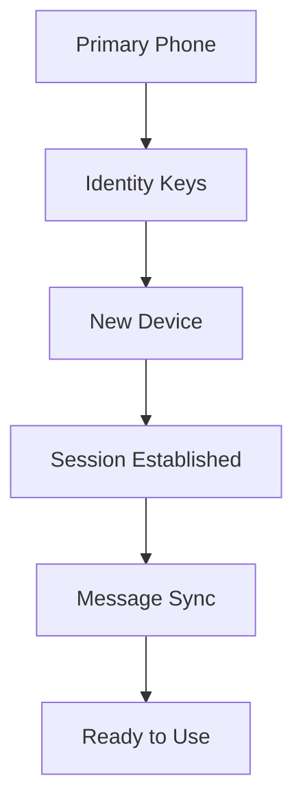

## What is MultiDevice?

WhatsApp's MultiDevice protocol allows you to use WhatsApp on multiple devices simultaneously without keeping your phone online. This is a significant advancement from the previous WhatsApp Web implementation that required your phone to be connected at all times.

## Key Benefits

<CardGroup cols={2}>
  <Card title="Independent Operation" icon="mobile-screen">
    Devices work independently without requiring the primary phone to be online
  </Card>
  <Card title="End-to-End Encryption" icon="lock">
    Messages remain encrypted across all devices using Signal Protocol
  </Card>
  <Card title="Synchronized State" icon="sync">
    Messages, contacts, and chat state sync across all connected devices
  </Card>
  <Card title="Multiple Connections" icon="network-wired">
    Connect up to 4 linked devices plus your primary phone
  </Card>
</CardGroup>

## How It Works

### Device Registration

When you connect a new device to WhatsApp:

1. **Identity Key Exchange**: Your phone shares identity keys with the new device
2. **Message History Sync**: Recent message history is synchronized
3. **Contact List Sync**: Contact information is shared across devices
4. **Session Establishment**: An independent session is created for the new device



### Message Delivery

Messages are delivered to all connected devices:

1. **Sender encrypts** message for all recipient devices
2. **WhatsApp servers** route messages to active devices
3. **Devices decrypt** messages independently
4. **Read receipts** are synchronized across devices

## Device Types

### Primary Device (Phone)
- Your main WhatsApp account
- Can link/unlink other devices
- Manages account settings
- Required for initial setup

### Linked Devices
- WhatsApp Web/Desktop
- Third-party clients (like this API)
- Business API integrations
- Maximum of 4 linked devices

## Connection States

The API handles different connection states:

| State | Description | Capabilities |
|-------|-------------|--------------|
| `CONNECTED` | Fully connected and synchronized | Full messaging capabilities |
| `CONNECTING` | Establishing connection | Limited functionality |
| `PAIRING` | Initial device pairing process | Authentication only |
| `DISCONNECTED` | Lost connection | No messaging capabilities |
| `LOGGED_OUT` | Session terminated | Re-authentication required |

## Session Management

### Session Persistence

The API maintains session data locally:

```bash
# Session files location
./database/
├── session.db          # Session database
├── keys/              # Encryption keys
└── media_cache/       # Cached media files
```

### Session Recovery

If the connection is lost, the API attempts automatic recovery:

1. **Reconnect**: Try to restore existing session
2. **Re-authenticate**: If session is invalid, require new authentication
3. **State Sync**: Synchronize missed messages and updates

## Message Synchronization

### Initial Sync

When a device connects for the first time:

- **Recent Messages**: Last 30 days of message history
- **Contact List**: All WhatsApp contacts
- **Group Information**: Group memberships and metadata
- **Chat Settings**: Chat-specific preferences

### Ongoing Sync

During normal operation:

- **Real-time Messages**: New messages arrive immediately
- **Read Receipts**: Read status synchronized across devices
- **Typing Indicators**: Typing status shared with contacts
- **Presence Updates**: Online/offline status synchronized

## Security Considerations

### Encryption

Each device maintains its own encryption keys:

```javascript
// Example: Message encryption flow
const messageToSend = "Hello, World!";

// 1. Generate device-specific keys
const deviceKeys = generateDeviceKeys();

// 2. Encrypt for all recipient devices
const encryptedMessages = recipients.map(device => 
  encrypt(messageToSend, device.publicKey)
);

// 3. Send to WhatsApp servers
await sendEncryptedMessages(encryptedMessages);
```

### Key Rotation

Keys are periodically rotated for security:

- **Signal Protocol**: Implements Double Ratchet algorithm
- **Forward Secrecy**: Old messages remain secure even if keys are compromised
- **Automatic Rotation**: Keys rotate automatically during conversations

## API Integration

### Device Registration

When using the API, device registration happens through:

```javascript
// 1. Request QR code or pairing code
const authResponse = await fetch('/app/login');

// 2. User scans QR code or enters pairing code
// 3. API receives authentication confirmation

// 4. Device is now registered and ready
const devices = await fetch('/app/devices');
```

### Message Handling

The API handles MultiDevice complexities automatically:

```javascript
// Send message - API handles device routing
await fetch('/send/message', {
  method: 'POST',
  body: JSON.stringify({
    phone: '6289685028129@s.whatsapp.net',
    message: 'Hello from API!'
  })
});

// Receive messages - API receives from all sender devices
// and presents unified message stream
```

## Best Practices

<AccordionGroup>
  <Accordion icon="shield" title="Security">
    - Store session data securely
    - Implement proper access controls
    - Monitor for unauthorized device connections
    - Regularly audit connected devices
  </Accordion>
  
  <Accordion icon="performance" title="Performance">
    - Cache frequently accessed data
    - Implement connection pooling
    - Handle network interruptions gracefully
    - Monitor device sync status
  </Accordion>
  
  <Accordion icon="sync" title="Synchronization">
    - Handle out-of-order message delivery
    - Implement proper conflict resolution
    - Monitor sync lag between devices
    - Gracefully handle partial syncs
  </Accordion>
</AccordionGroup>

## Limitations

### Device Limits
- Maximum 4 linked devices per account
- Primary phone cannot be removed
- Device linking requires primary phone approval

### Network Requirements
- Stable internet connection required
- Higher bandwidth during initial sync
- Intermittent connectivity may cause sync delays

### Message Limits
- Large media files may sync slowly
- Some message types may not sync immediately
- Group admin actions require primary device

## Monitoring MultiDevice Status

### Check Connected Devices

```javascript
const checkDevices = async () => {
  const response = await fetch('/app/devices');
  const data = await response.json();
  
  console.log('Connected devices:', data.results.length);
  data.results.forEach(device => {
    console.log(`- ${device.name}: ${device.device}`);
  });
};
```

### Monitor Sync Status

```javascript
const monitorSync = async () => {
  // Check if messages are being received in real-time
  const lastMessage = await getLastMessage();
  const now = new Date();
  const delay = now - new Date(lastMessage.timestamp);
  
  if (delay > 30000) { // More than 30 seconds delay
    console.warn('Message sync may be delayed');
  }
};
```

## Troubleshooting

<AccordionGroup>
  <Accordion icon="triangle-exclamation" title="Sync Issues">
    **Symptoms**: Messages not appearing on all devices
    
    **Solutions**:
    - Check network connectivity
    - Restart API connection
    - Verify device registration status
    - Check for account restrictions
  </Accordion>
  
  <Accordion icon="triangle-exclamation" title="Connection Drops">
    **Symptoms**: Frequent disconnections
    
    **Solutions**:
    - Monitor network stability
    - Implement reconnection logic
    - Check server logs for errors
    - Verify WhatsApp account status
  </Accordion>
  
  <Accordion icon="triangle-exclamation" title="Device Limit Reached">
    **Symptoms**: Cannot connect new device
    
    **Solutions**:
    - Check connected devices: `/app/devices`
    - Remove unused devices from WhatsApp
    - Verify device count limits
  </Accordion>
</AccordionGroup>

## Next Steps

<CardGroup cols={2}>
  <Card title="Sessions" icon="database" href="/concepts/sessions">
    Learn about session management
  </Card>
  
  <Card title="Webhooks" icon="webhook" href="/concepts/webhooks">
    Receive real-time notifications
  </Card>
  
  <Card title="Message Examples" icon="message" href="/examples/sending-messages">
    Start sending messages
  </Card>
  
  <Card title="Best Practices" icon="star" href="/advanced/best-practices">
    Production deployment tips
  </Card>
</CardGroup>