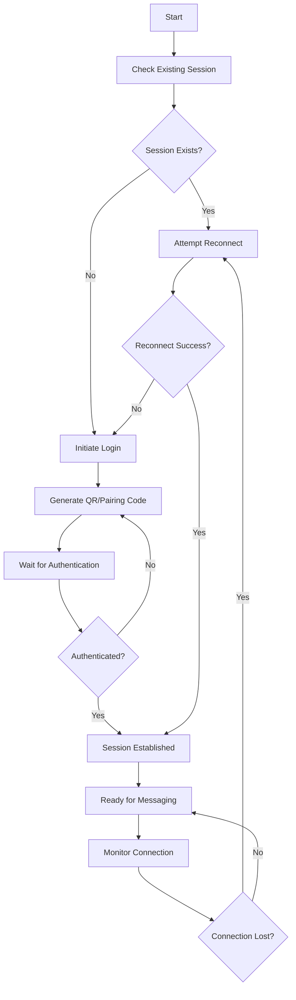

## Overview

WhatsApp API sessions represent the connection state between your API and WhatsApp servers. Proper session management is crucial for maintaining stable connections and ensuring message delivery reliability.

## Session Lifecycle

### Session States

| State | Description | Actions Available |
|-------|-------------|-------------------|
| `DISCONNECTED` | No active session | Login, Connect |
| `CONNECTING` | Establishing connection | Wait, Monitor |
| `AUTHENTICATING` | QR/Pairing code verification | Scan QR, Enter code |
| `CONNECTED` | Fully authenticated and ready | Send/Receive messages |
| `RECONNECTING` | Recovering lost connection | Wait, Manual reconnect |
| `LOGGED_OUT` | Session terminated | Re-authenticate |

### Session Flow



## Session Storage

### Local Session Data

The API stores session data locally to enable automatic reconnection:

```bash
./database/
├── session.db          # SQLite database with session info
├── keys/
│   ├── pre-key-1.json  # Pre-keys for encryption
│   ├── pre-key-2.json
│   └── identity.json   # Identity keys
├── media_cache/        # Cached media files
└── logs/
    └── session.log     # Session activity logs
```

### Session Configuration

```yaml
# config.yml
session:
  store_type: "file"     # file, redis, database
  store_path: "./database"
  auto_reconnect: true
  reconnect_interval: 30  # seconds
  max_reconnect_attempts: 5
  session_timeout: 3600   # 1 hour
```

## Session Management API

### Check Session Status

<CodeGroup>
```bash cURL
curl -X GET http://localhost:3000/app/devices
```

```javascript JavaScript
async function checkSessionStatus() {
  try {
    const response = await fetch('http://localhost:3000/app/devices');
    const result = await response.json();
    
    if (result.code === 'SUCCESS' && result.results.length > 0) {
      console.log('✅ Session active:', result.results[0]);
      return {
        status: 'connected',
        device: result.results[0]
      };
    } else {
      console.log('❌ No active session');
      return {
        status: 'disconnected'
      };
    }
  } catch (error) {
    console.error('Failed to check session:', error);
    return {
      status: 'error',
      error: error.message
    };
  }
}

// Usage
const sessionStatus = await checkSessionStatus();
console.log('Session status:', sessionStatus);
```

```python Python
import requests

def check_session_status():
    try:
        response = requests.get('http://localhost:3000/app/devices')
        result = response.json()
        
        if result['code'] == 'SUCCESS' and len(result['results']) > 0:
            print('✅ Session active:', result['results'][0])
            return {
                'status': 'connected',
                'device': result['results'][0]
            }
        else:
            print('❌ No active session')
            return {'status': 'disconnected'}
            
    except Exception as error:
        print('Failed to check session:', error)
        return {
            'status': 'error',
            'error': str(error)
        }

# Usage
session_status = check_session_status()
print('Session status:', session_status)
```
</CodeGroup>

### Session Reconnection

<CodeGroup>
```bash cURL
curl -X GET http://localhost:3000/app/reconnect
```

```javascript JavaScript
async function reconnectSession() {
  try {
    const response = await fetch('http://localhost:3000/app/reconnect');
    const result = await response.json();
    
    if (result.code === 'SUCCESS') {
      console.log('✅ Reconnection initiated');
      
      // Wait and check if reconnection was successful
      setTimeout(async () => {
        const status = await checkSessionStatus();
        if (status.status === 'connected') {
          console.log('✅ Successfully reconnected');
        } else {
          console.log('❌ Reconnection failed, manual login required');
        }
      }, 5000);
      
      return result;
    } else {
      throw new Error(result.message);
    }
  } catch (error) {
    console.error('Reconnection failed:', error);
    throw error;
  }
}
```
</CodeGroup>

### Session Logout

<CodeGroup>
```bash cURL
curl -X GET http://localhost:3000/app/logout
```

```javascript JavaScript
async function logoutSession() {
  try {
    const response = await fetch('http://localhost:3000/app/logout');
    const result = await response.json();
    
    if (result.code === 'SUCCESS') {
      console.log('✅ Session logged out successfully');
      return result;
    } else {
      throw new Error(result.message);
    }
  } catch (error) {
    console.error('Logout failed:', error);
    throw error;
  }
}

// Warning: This will require re-authentication
await logoutSession();
```
</CodeGroup>

## Advanced Session Management

### Session Monitor Class

```javascript
class SessionMonitor {
  constructor(apiUrl, options = {}) {
    this.apiUrl = apiUrl;
    this.checkInterval = options.checkInterval || 30000; // 30 seconds
    this.maxReconnectAttempts = options.maxReconnectAttempts || 5;
    this.reconnectDelay = options.reconnectDelay || 10000; // 10 seconds
    this.onStatusChange = options.onStatusChange || (() => {});
    this.onError = options.onError || (() => {});
    
    this.currentStatus = 'unknown';
    this.reconnectAttempts = 0;
    this.isMonitoring = false;
    this.monitorTimer = null;
  }
  
  start() {
    if (this.isMonitoring) return;
    
    this.isMonitoring = true;
    this.monitor();
    console.log('📊 Session monitoring started');
  }
  
  stop() {
    this.isMonitoring = false;
    if (this.monitorTimer) {
      clearTimeout(this.monitorTimer);
      this.monitorTimer = null;
    }
    console.log('📊 Session monitoring stopped');
  }
  
  async monitor() {
    while (this.isMonitoring) {
      try {
        const status = await this.checkStatus();
        await this.handleStatusChange(status);
        
        // Wait before next check
        await this.sleep(this.checkInterval);
      } catch (error) {
        console.error('Monitoring error:', error);
        this.onError(error);
        
        // Wait longer on error
        await this.sleep(this.checkInterval * 2);
      }
    }
  }
  
  async checkStatus() {
    try {
      const response = await fetch(`${this.apiUrl}/app/devices`);
      const result = await response.json();
      
      if (result.code === 'SUCCESS' && result.results.length > 0) {
        return {
          status: 'connected',
          device: result.results[0],
          timestamp: new Date()
        };
      } else {
        return {
          status: 'disconnected',
          timestamp: new Date()
        };
      }
    } catch (error) {
      return {
        status: 'error',
        error: error.message,
        timestamp: new Date()
      };
    }
  }
  
  async handleStatusChange(newStatus) {
    const previousStatus = this.currentStatus;
    this.currentStatus = newStatus.status;
    
    if (previousStatus !== newStatus.status) {
      console.log(`📱 Session status changed: ${previousStatus} → ${newStatus.status}`);
      this.onStatusChange(newStatus, previousStatus);
      
      // Handle disconnection
      if (newStatus.status === 'disconnected' || newStatus.status === 'error') {
        await this.handleDisconnection();
      } else if (newStatus.status === 'connected') {
        // Reset reconnect attempts on successful connection
        this.reconnectAttempts = 0;
      }
    }
  }
  
  async handleDisconnection() {
    if (this.reconnectAttempts >= this.maxReconnectAttempts) {
      console.error('🚨 Max reconnection attempts reached. Manual intervention required.');
      this.onError(new Error('Max reconnection attempts exceeded'));
      return;
    }
    
    this.reconnectAttempts++;
    console.log(`🔄 Attempting reconnection ${this.reconnectAttempts}/${this.maxReconnectAttempts}`);
    
    try {
      // Wait before attempting reconnection
      await this.sleep(this.reconnectDelay);
      
      const response = await fetch(`${this.apiUrl}/app/reconnect`);
      const result = await response.json();
      
      if (result.code === 'SUCCESS') {
        console.log('✅ Reconnection initiated');
      } else {
        console.error('❌ Reconnection failed:', result.message);
      }
    } catch (error) {
      console.error('❌ Reconnection attempt failed:', error);
    }
  }
  
  sleep(ms) {
    return new Promise(resolve => setTimeout(resolve, ms));
  }
  
  getStatus() {
    return {
      currentStatus: this.currentStatus,
      reconnectAttempts: this.reconnectAttempts,
      isMonitoring: this.isMonitoring
    };
  }
}

// Usage
const monitor = new SessionMonitor('http://localhost:3000', {
  checkInterval: 30000,
  maxReconnectAttempts: 5,
  onStatusChange: (newStatus, previousStatus) => {
    console.log(`Status changed from ${previousStatus} to ${newStatus.status}`);
    
    // Send notifications, update UI, etc.
    if (newStatus.status === 'connected') {
      // Notify that API is ready
      notifyApiReady();
    } else if (newStatus.status === 'disconnected') {
      // Notify about disconnection
      notifyApiDisconnected();
    }
  },
  onError: (error) => {
    console.error('Session monitor error:', error);
    // Send alerts, log to external service, etc.
  }
});

// Start monitoring
monitor.start();

// Stop monitoring when needed
// monitor.stop();
```

### Session Recovery

```javascript
class SessionRecovery {
  constructor(apiUrl) {
    this.apiUrl = apiUrl;
    this.recoveryStrategies = [
      this.softReconnect,
      this.hardReconnect,
      this.reAuthenticate
    ];
  }
  
  async recoverSession() {
    console.log('🔧 Starting session recovery...');
    
    for (const [index, strategy] of this.recoveryStrategies.entries()) {
      try {
        console.log(`Trying recovery strategy ${index + 1}/${this.recoveryStrategies.length}`);
        
        const success = await strategy.call(this);
        
        if (success) {
          console.log('✅ Session recovery successful');
          return true;
        }
      } catch (error) {
        console.error(`Recovery strategy ${index + 1} failed:`, error);
      }
      
      // Wait between strategies
      if (index < this.recoveryStrategies.length - 1) {
        await this.sleep(5000);
      }
    }
    
    console.error('❌ All recovery strategies failed');
    return false;
  }
  
  async softReconnect() {
    console.log('🔄 Attempting soft reconnect...');
    
    const response = await fetch(`${this.apiUrl}/app/reconnect`);
    const result = await response.json();
    
    if (result.code === 'SUCCESS') {
      // Wait for connection to establish
      await this.sleep(10000);
      
      const status = await this.checkConnection();
      return status === 'connected';
    }
    
    return false;
  }
  
  async hardReconnect() {
    console.log('🔄 Attempting hard reconnect...');
    
    // First logout to clear session
    try {
      await fetch(`${this.apiUrl}/app/logout`);
      await this.sleep(2000);
    } catch (error) {
      console.warn('Logout failed during hard reconnect:', error);
    }
    
    // Then try to reconnect
    const response = await fetch(`${this.apiUrl}/app/reconnect`);
    const result = await response.json();
    
    if (result.code === 'SUCCESS') {
      await this.sleep(15000);
      
      const status = await this.checkConnection();
      return status === 'connected';
    }
    
    return false;
  }
  
  async reAuthenticate() {
    console.log('🔐 Re-authentication required');
    
    // This would require user intervention to scan QR code
    // In automated systems, you might want to notify administrators
    throw new Error('Manual re-authentication required');
  }
  
  async checkConnection() {
    try {
      const response = await fetch(`${this.apiUrl}/app/devices`);
      const result = await response.json();
      
      if (result.code === 'SUCCESS' && result.results.length > 0) {
        return 'connected';
      } else {
        return 'disconnected';
      }
    } catch (error) {
      return 'error';
    }
  }
  
  sleep(ms) {
    return new Promise(resolve => setTimeout(resolve, ms));
  }
}

// Usage
const recovery = new SessionRecovery('http://localhost:3000');

// Trigger recovery when needed
async function handleSessionLoss() {
  const recovered = await recovery.recoverSession();
  
  if (!recovered) {
    // Notify administrators or trigger manual intervention
    console.error('🚨 Manual intervention required for session recovery');
    // Send alert to monitoring system
  }
}
```

## Session Persistence

### Database Session Storage

```javascript
class DatabaseSessionStore {
  constructor(dbConfig) {
    this.db = dbConfig; // Your database connection
  }
  
  async saveSession(sessionData) {
    try {
      const session = {
        id: sessionData.device || 'default',
        device_name: sessionData.name,
        device_id: sessionData.device,
        connected_at: new Date(),
        last_activity: new Date(),
        session_data: JSON.stringify(sessionData),
        status: 'active'
      };
      
      await this.db.query(`
        INSERT INTO whatsapp_sessions (id, device_name, device_id, connected_at, last_activity, session_data, status)
        VALUES (?, ?, ?, ?, ?, ?, ?)
        ON DUPLICATE KEY UPDATE
        last_activity = VALUES(last_activity),
        session_data = VALUES(session_data),
        status = VALUES(status)
      `, [session.id, session.device_name, session.device_id, session.connected_at, session.last_activity, session.session_data, session.status]);
      
      console.log('Session saved to database');
    } catch (error) {
      console.error('Failed to save session:', error);
    }
  }
  
  async loadSession(sessionId = 'default') {
    try {
      const result = await this.db.query(
        'SELECT * FROM whatsapp_sessions WHERE id = ? AND status = "active"',
        [sessionId]
      );
      
      if (result.length > 0) {
        const session = result[0];
        return {
          ...JSON.parse(session.session_data),
          connected_at: session.connected_at,
          last_activity: session.last_activity
        };
      }
      
      return null;
    } catch (error) {
      console.error('Failed to load session:', error);
      return null;
    }
  }
  
  async updateLastActivity(sessionId = 'default') {
    try {
      await this.db.query(
        'UPDATE whatsapp_sessions SET last_activity = NOW() WHERE id = ?',
        [sessionId]
      );
    } catch (error) {
      console.error('Failed to update last activity:', error);
    }
  }
  
  async markSessionInactive(sessionId = 'default') {
    try {
      await this.db.query(
        'UPDATE whatsapp_sessions SET status = "inactive", disconnected_at = NOW() WHERE id = ?',
        [sessionId]
      );
    } catch (error) {
      console.error('Failed to mark session inactive:', error);
    }
  }
}
```

### Redis Session Storage

```javascript
class RedisSessionStore {
  constructor(redisClient) {
    this.redis = redisClient;
    this.keyPrefix = 'whatsapp:session:';
    this.defaultTTL = 86400; // 24 hours
  }
  
  async saveSession(sessionData, sessionId = 'default') {
    try {
      const key = this.keyPrefix + sessionId;
      const data = {
        ...sessionData,
        saved_at: new Date().toISOString(),
        last_activity: new Date().toISOString()
      };
      
      await this.redis.setex(key, this.defaultTTL, JSON.stringify(data));
      console.log(`Session ${sessionId} saved to Redis`);
    } catch (error) {
      console.error('Failed to save session to Redis:', error);
    }
  }
  
  async loadSession(sessionId = 'default') {
    try {
      const key = this.keyPrefix + sessionId;
      const data = await this.redis.get(key);
      
      if (data) {
        return JSON.parse(data);
      }
      
      return null;
    } catch (error) {
      console.error('Failed to load session from Redis:', error);
      return null;
    }
  }
  
  async updateLastActivity(sessionId = 'default') {
    try {
      const session = await this.loadSession(sessionId);
      if (session) {
        session.last_activity = new Date().toISOString();
        await this.saveSession(session, sessionId);
      }
    } catch (error) {
      console.error('Failed to update last activity in Redis:', error);
    }
  }
  
  async deleteSession(sessionId = 'default') {
    try {
      const key = this.keyPrefix + sessionId;
      await this.redis.del(key);
      console.log(`Session ${sessionId} deleted from Redis`);
    } catch (error) {
      console.error('Failed to delete session from Redis:', error);
    }
  }
}
```

## Session Security

### Session Validation

```javascript
class SessionValidator {
  constructor(options = {}) {
    this.maxInactiveTime = options.maxInactiveTime || 3600000; // 1 hour
    this.requiredFields = ['device', 'name'];
  }
  
  validateSession(sessionData) {
    const errors = [];
    
    // Check required fields
    for (const field of this.requiredFields) {
      if (!sessionData[field]) {
        errors.push(`Missing required field: ${field}`);
      }
    }
    
    // Check session age
    if (sessionData.last_activity) {
      const lastActivity = new Date(sessionData.last_activity);
      const now = new Date();
      const inactiveTime = now - lastActivity;
      
      if (inactiveTime > this.maxInactiveTime) {
        errors.push('Session has been inactive for too long');
      }
    }
    
    // Check session integrity
    if (!this.verifySessionIntegrity(sessionData)) {
      errors.push('Session integrity check failed');
    }
    
    return {
      isValid: errors.length === 0,
      errors
    };
  }
  
  verifySessionIntegrity(sessionData) {
    // Implement session integrity checks
    // e.g., signature verification, checksum validation
    return true; // Simplified for example
  }
  
  sanitizeSession(sessionData) {
    // Remove sensitive data before logging/storing
    const sanitized = { ...sessionData };
    delete sanitized.privateKey;
    delete sanitized.identityKey;
    return sanitized;
  }
}
```

## Best Practices

<AccordionGroup>
  <Accordion icon="shield" title="Security">
    - Store session data securely with encryption
    - Implement session validation and integrity checks
    - Use secure authentication methods
    - Monitor for unauthorized access attempts
    - Rotate encryption keys regularly
  </Accordion>
  
  <Accordion icon="performance" title="Performance">
    - Use efficient session storage (Redis, database)
    - Implement session caching for frequently accessed data
    - Monitor session storage usage
    - Clean up expired sessions regularly
    - Use connection pooling for database operations
  </Accordion>
  
  <Accordion icon="sync" title="Reliability">
    - Implement automatic reconnection logic
    - Use multiple recovery strategies
    - Monitor session health continuously
    - Set up alerts for session failures
    - Maintain session backups for critical applications
  </Accordion>
  
  <Accordion icon="database" title="Data Management">
    - Store session metadata for analytics
    - Implement session logging for debugging
    - Use database transactions for consistency
    - Archive old session data appropriately
    - Monitor session-related metrics
  </Accordion>
</AccordionGroup>

## Troubleshooting

<AccordionGroup>
  <Accordion icon="triangle-exclamation" title="Connection Drops">
    **Symptoms**: Frequent disconnections, messages not sending
    
    **Solutions**:
    - Check network stability
    - Verify WhatsApp account status
    - Review session logs for errors
    - Implement proper reconnection logic
    - Monitor API response times
  </Accordion>
  
  <Accordion icon="triangle-exclamation" title="Session Corruption">
    **Symptoms**: Authentication failures, invalid session errors
    
    **Solutions**:
    - Clear session data and re-authenticate
    - Verify session file permissions
    - Check for disk space issues
    - Validate session data integrity
    - Restore from backup if available
  </Accordion>
  
  <Accordion icon="triangle-exclamation" title="Memory Issues">
    **Symptoms**: High memory usage, slow performance
    
    **Solutions**:
    - Monitor session storage usage
    - Implement session cleanup routines
    - Use external session storage (Redis/Database)
    - Optimize session data structure
    - Set appropriate TTL values
  </Accordion>
</AccordionGroup>

## Next Steps

<CardGroup cols={2}>
  <Card title="Webhooks" icon="webhook" href="/concepts/webhooks">
    Set up real-time event notifications
  </Card>
  
  <Card title="MultiDevice" icon="mobile" href="/concepts/multidevice">
    Understand the MultiDevice protocol
  </Card>
  
  <Card title="Best Practices" icon="star" href="/advanced/best-practices">
    Production deployment guidelines
  </Card>
  
  <Card title="Error Handling" icon="triangle-exclamation" href="/advanced/error-handling">
    Handle session-related errors
  </Card>
</CardGroup>