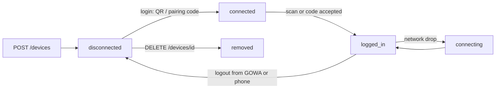

A **session** is the cryptographic identity WhatsApp issues when you pair a device slot. GOWA keeps it in its database, so a slot stays linked across restarts until it is logged out from GOWA or from the phone.

## Lifecycle



| Event | What GOWA does |
| --- | --- |
| Server start | Loads every slot and, about 2 seconds after boot, reconnects the ones with a stored session. |
| Connection lost | whatsmeow reconnects automatically. A background check also runs every 5 minutes and reconnects a dropped client. |
| Manual reconnect | `POST /devices/{device_id}/reconnect` or `GET /app/reconnect`. |
| Logout | `POST /devices/{device_id}/logout` or `GET /app/logout`. Unlinks from WhatsApp, deletes the session keys, keeps the slot. |
| Unlinked from the phone | Same as logout: the slot remains and must be paired again. |
| Removal | `DELETE /devices/{device_id}`. Logs out, then deletes the slot and its chat data. |

Check a slot at any time:

```bash
curl -u admin:changeme http://localhost:3000/devices/my-device/status
```

`is_connected` reflects the socket; `is_logged_in` reflects whether the session is valid. Both must be `true` to send.

## Where sessions are stored

| Setting | Default | Contents |
| --- | --- | --- |
| `DB_URI` | `file:storages/whatsapp.db` | whatsmeow device store: identity keys, sessions, contacts. SQLite or PostgreSQL (`postgres://...`). |
| `DB_KEYS_URI` | empty (uses `DB_URI`) | Optional separate database for the encryption key cache. Avoid in-memory storage in production; a restart would lose session state. |
| (fixed) | `file:storages/chatstorage.db` | Device registry, chat and message history, scheduled sends, Chatwoot links. |

Anyone with these files can act as the linked accounts. GOWA creates local storage directories with mode `0700` and protects local session database files and SQLite sidecars with mode `0600`. Keep backups encrypted and preserve those permissions when restoring. Do not place session storage under the public `statics/` directory.

### Back up and restore

Stop GOWA (or snapshot the volume), then copy `storages/`. With PostgreSQL for `DB_URI`, back up that database **and** `storages/chatstorage.db` together. Restoring both brings every slot back without pairing again.

Do not run two GOWA instances against the same session data. WhatsApp sees two clients with one identity and disconnects one of them.

A slot keeps its per-device webhook URL, signing key, and event filters when you log out and pair again. Deleting the slot removes its configuration. Subscribe to `device.logged_out`, `device.temporary_ban`, and `device.reachout_timelock` to distinguish account restrictions from a network disconnect. See [Webhooks](/concepts/webhooks).

For managed PostgreSQL sessions, see the [Neon setup guide](https://github.com/aldinokemal/go-whatsapp-web-multidevice/blob/main/docs/neon.md). Changing `DB_URI` does not migrate existing sessions. The registry and chat history remain in local SQLite, so persist `storages/` too.

## Presence

| Setting | Default | Effect |
| --- | --- | --- |
| `WHATSAPP_PRESENCE_ON_CONNECT` | `unavailable` | Presence sent after connecting: `available`, `unavailable` or `none`. |
| `WHATSAPP_PRESENCE_PULSE_ENABLED` | `true` | Periodically marks the account `available` for a short window, then `unavailable` again. |
| `WHATSAPP_PRESENCE_PULSE_INTERVAL` | `24h` | Time between pulses. |
| `WHATSAPP_PRESENCE_PULSE_DURATION` | `5m` | How long each pulse stays `available`. |

Set presence manually with `POST /send/presence` (`{"type": "available"}` or `"unavailable"`).

## Troubleshooting

| Symptom | Likely cause | Fix |
| --- | --- | --- |
| `is_logged_in: false` after a restart | Session was unlinked from the phone, or `storages/` was not persisted. | Mount `/app/storages` as a volume; pair again. |
| Slot keeps disconnecting | Another process uses the same session, or the phone has been offline for about 14 days. | Run a single instance; open WhatsApp on the phone. |
| QR expires before scanning | `qr_duration` elapsed. | Call the login endpoint again, or use a pairing code. |
| Sends fail with "not logged in" | Slot exists but is not paired. | Check `/devices/{device_id}/status`; pair again. |
