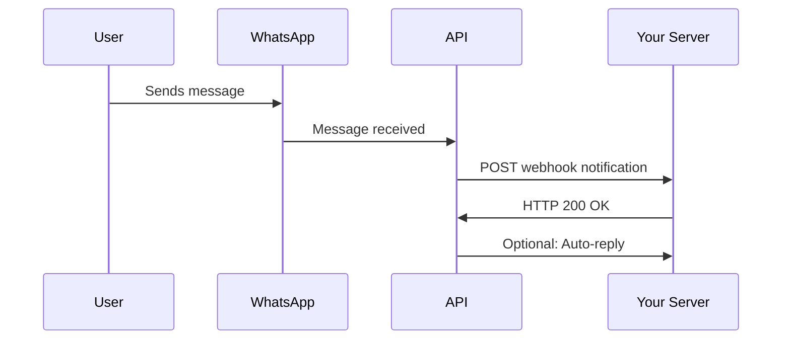

## Overview

Webhooks provide real-time notifications when events occur in your WhatsApp API, such as incoming messages, message status updates, and group activities. Instead of polling for updates, webhooks push notifications to your server instantly.

## How Webhooks Work

When an event occurs (like receiving a message), the WhatsApp API sends an HTTP POST request to your configured webhook URL with event data. Your server processes this data and responds with an HTTP 200 status to acknowledge receipt.



## Webhook Configuration

### Setting Up Webhooks

<CodeGroup>
```bash cURL
curl -X POST http://localhost:3000/webhook/set \
  -H "Content-Type: application/json" \
  -d '{
    "url": "https://your-server.com/webhook",
    "events": ["message", "message_ack", "group_update"],
    "secret": "your-webhook-secret"
  }'
```

```javascript JavaScript
const response = await fetch('http://localhost:3000/webhook/set', {
  method: 'POST',
  headers: {
    'Content-Type': 'application/json'
  },
  body: JSON.stringify({
    url: 'https://your-server.com/webhook',
    events: ['message', 'message_ack', 'group_update'],
    secret: 'your-webhook-secret'
  })
});

const result = await response.json();
console.log('Webhook configured:', result);
```

```python Python
import requests

url = "http://localhost:3000/webhook/set"
payload = {
    "url": "https://your-server.com/webhook",
    "events": ["message", "message_ack", "group_update"],
    "secret": "your-webhook-secret"
}

response = requests.post(url, json=payload)
result = response.json()
print("Webhook configured:", result)
```
</CodeGroup>

### Webhook Events

| Event Type | Description | Trigger |
|------------|-------------|---------|
| `message` | New message received | User sends message to bot |
| `message_ack` | Message status update | Message delivered/read |
| `group_update` | Group changes | Member added/removed, settings changed |
| `presence_update` | User status change | Online/offline, typing |
| `call` | Incoming call | Voice/video call received |
| `connection_update` | Connection status | Connected/disconnected |

## Webhook Payloads

### Message Event

```json
{
  "event": "message",
  "timestamp": "2024-01-15T10:30:00Z",
  "data": {
    "id": "3EB0B430B6F8F1D0E053AC120E0A9E5C",
    "from": "6289685028129@s.whatsapp.net",
    "to": "6289685028130@s.whatsapp.net",
    "timestamp": "2024-01-15T10:30:00Z",
    "type": "text",
    "body": "Hello! How are you?",
    "fromMe": false,
    "hasMedia": false,
    "participant": null,
    "isGroup": false,
    "groupId": null,
    "quotedMessage": null,
    "location": null,
    "contact": null
  }
}
```

### Media Message Event

```json
{
  "event": "message",
  "timestamp": "2024-01-15T10:30:00Z",
  "data": {
    "id": "3EB0B430B6F8F1D0E053AC120E0A9E5C",
    "from": "6289685028129@s.whatsapp.net",
    "to": "6289685028130@s.whatsapp.net",
    "timestamp": "2024-01-15T10:30:00Z",
    "type": "image",
    "body": "Check out this photo!",
    "fromMe": false,
    "hasMedia": true,
    "media": {
      "url": "https://api.example.com/media/image123.jpg",
      "mimetype": "image/jpeg",
      "filename": "photo.jpg",
      "size": 1024768,
      "caption": "Check out this photo!"
    }
  }
}
```

### Group Update Event

```json
{
  "event": "group_update",
  "timestamp": "2024-01-15T10:30:00Z",
  "data": {
    "groupId": "120363347168689807@g.us",
    "action": "participant_add",
    "participants": ["6289685028129@s.whatsapp.net"],
    "actor": "6289685028130@s.whatsapp.net"
  }
}
```

### Message Acknowledgment Event

```json
{
  "event": "message_ack",
  "timestamp": "2024-01-15T10:30:00Z",
  "data": {
    "messageId": "3EB0B430B6F8F1D0E053AC120E0A9E5C",
    "from": "6289685028129@s.whatsapp.net",
    "status": "read",
    "timestamp": "2024-01-15T10:30:00Z"
  }
}
```

## Webhook Server Implementation

### Node.js/Express Server

```javascript
const express = require('express');
const crypto = require('crypto');
const app = express();

// Middleware to verify webhook signature
function verifyWebhookSignature(req, res, next) {
  const signature = req.headers['x-webhook-signature'];
  const payload = JSON.stringify(req.body);
  const secret = process.env.WEBHOOK_SECRET;
  
  const expectedSignature = crypto
    .createHmac('sha256', secret)
    .update(payload)
    .digest('hex');
  
  if (signature !== expectedSignature) {
    return res.status(401).json({ error: 'Invalid signature' });
  }
  
  next();
}

app.use(express.json());

app.post('/webhook', verifyWebhookSignature, async (req, res) => {
  const { event, data } = req.body;
  
  console.log(`Received ${event} event:`, data);
  
  try {
    switch (event) {
      case 'message':
        await handleIncomingMessage(data);
        break;
      case 'message_ack':
        await handleMessageAck(data);
        break;
      case 'group_update':
        await handleGroupUpdate(data);
        break;
      case 'presence_update':
        await handlePresenceUpdate(data);
        break;
      default:
        console.log('Unknown event type:', event);
    }
    
    // Always respond with 200 OK
    res.status(200).json({ status: 'received' });
  } catch (error) {
    console.error('Webhook processing error:', error);
    res.status(500).json({ error: 'Processing failed' });
  }
});

async function handleIncomingMessage(message) {
  console.log(`New message from ${message.from}: ${message.body}`);
  
  // Log message to database
  await logMessage(message);
  
  // Process different message types
  if (message.hasMedia) {
    await handleMediaMessage(message);
  } else {
    await handleTextMessage(message);
  }
  
  // Auto-reply logic
  if (!message.fromMe && !message.isGroup) {
    await processAutoReply(message);
  }
}

async function handleTextMessage(message) {
  // Handle text-specific logic
  if (message.body.startsWith('/')) {
    await handleCommand(message);
  }
}

async function handleMediaMessage(message) {
  console.log(`Media message: ${message.type}`);
  
  // Download and process media
  try {
    const mediaPath = await downloadMedia(message.id);
    await processMedia(mediaPath, message.type);
  } catch (error) {
    console.error('Media processing failed:', error);
  }
}

async function handleCommand(message) {
  const command = message.body.split(' ')[0].toLowerCase();
  const args = message.body.split(' ').slice(1);
  
  switch (command) {
    case '/help':
      await sendReply(message.from, 'Available commands:\n/help - Show help\n/status - Check status');
      break;
    case '/status':
      await sendReply(message.from, 'Bot is online and ready! ✅');
      break;
    default:
      await sendReply(message.from, 'Unknown command. Type /help for available commands.');
  }
}

async function processAutoReply(message) {
  // Simple auto-reply logic
  const responses = {
    'hello': 'Hi there! How can I help you?',
    'hi': 'Hello! Nice to meet you!',
    'help': 'I\'m here to help! What do you need assistance with?'
  };
  
  const lowerBody = message.body.toLowerCase();
  for (const [trigger, response] of Object.entries(responses)) {
    if (lowerBody.includes(trigger)) {
      await sendReply(message.from, response);
      break;
    }
  }
}

async function sendReply(to, message) {
  try {
    const response = await fetch('http://localhost:3000/send/message', {
      method: 'POST',
      headers: {
        'Content-Type': 'application/json'
      },
      body: JSON.stringify({
        phone: to,
        message: message
      })
    });
    
    const result = await response.json();
    console.log('Reply sent:', result);
  } catch (error) {
    console.error('Failed to send reply:', error);
  }
}

async function handleMessageAck(ack) {
  console.log(`Message ${ack.messageId} status: ${ack.status}`);
  // Update message status in database
  await updateMessageStatus(ack.messageId, ack.status);
}

async function handleGroupUpdate(update) {
  console.log(`Group ${update.groupId} update: ${update.action}`);
  
  switch (update.action) {
    case 'participant_add':
      await welcomeNewMembers(update.groupId, update.participants);
      break;
    case 'participant_remove':
      await logMemberRemoval(update.groupId, update.participants);
      break;
    case 'settings_update':
      await logSettingsChange(update.groupId, update.settings);
      break;
  }
}

async function welcomeNewMembers(groupId, participants) {
  for (const participant of participants) {
    const welcomeMessage = `Welcome to the group, @${participant}! 👋`;
    await sendGroupMessage(groupId, welcomeMessage);
  }
}

app.listen(8080, () => {
  console.log('Webhook server running on port 8080');
});
```

### Python/Flask Server

```python
from flask import Flask, request, jsonify
import hashlib
import hmac
import json
import requests
import os

app = Flask(__name__)

def verify_signature(payload, signature):
    secret = os.getenv('WEBHOOK_SECRET', 'your-secret')
    expected_signature = hmac.new(
        secret.encode('utf-8'),
        payload.encode('utf-8'),
        hashlib.sha256
    ).hexdigest()
    
    return hmac.compare_digest(signature, expected_signature)

@app.route('/webhook', methods=['POST'])
def webhook():
    # Verify signature
    signature = request.headers.get('X-Webhook-Signature')
    payload = request.get_data(as_text=True)
    
    if not verify_signature(payload, signature):
        return jsonify({'error': 'Invalid signature'}), 401
    
    data = request.get_json()
    event = data.get('event')
    event_data = data.get('data')
    
    print(f"Received {event} event:", event_data)
    
    try:
        if event == 'message':
            handle_incoming_message(event_data)
        elif event == 'message_ack':
            handle_message_ack(event_data)
        elif event == 'group_update':
            handle_group_update(event_data)
        
        return jsonify({'status': 'received'}), 200
        
    except Exception as e:
        print(f"Webhook processing error: {e}")
        return jsonify({'error': 'Processing failed'}), 500

def handle_incoming_message(message):
    print(f"New message from {message['from']}: {message['body']}")
    
    # Auto-reply logic
    if not message['fromMe'] and not message['isGroup']:
        process_auto_reply(message)

def process_auto_reply(message):
    body = message['body'].lower()
    
    if 'hello' in body or 'hi' in body:
        send_reply(message['from'], 'Hello! How can I help you?')
    elif 'help' in body:
        send_reply(message['from'], 'I\'m here to help! What do you need?')

def send_reply(to, message_text):
    try:
        response = requests.post('http://localhost:3000/send/message', 
            json={
                'phone': to,
                'message': message_text
            })
        print(f"Reply sent: {response.json()}")
    except Exception as e:
        print(f"Failed to send reply: {e}")

def handle_message_ack(ack):
    print(f"Message {ack['messageId']} status: {ack['status']}")

def handle_group_update(update):
    print(f"Group {update['groupId']} update: {update['action']}")

if __name__ == '__main__':
    app.run(host='0.0.0.0', port=8080, debug=True)
```

## Advanced Webhook Handling

### Webhook Queue System

```javascript
const Bull = require('bull');

class WebhookProcessor {
  constructor() {
    this.queue = new Bull('webhook processing');
    this.setupProcessors();
  }
  
  setupProcessors() {
    // Process different event types with different priorities
    this.queue.process('message', 10, async (job) => {
      return await this.processMessage(job.data);
    });
    
    this.queue.process('message_ack', 5, async (job) => {
      return await this.processMessageAck(job.data);
    });
    
    this.queue.process('group_update', 3, async (job) => {
      return await this.processGroupUpdate(job.data);
    });
  }
  
  async enqueueEvent(event, data, options = {}) {
    const priority = this.getEventPriority(event);
    
    await this.queue.add(event, data, {
      priority,
      attempts: 3,
      backoff: 'exponential',
      delay: options.delay || 0,
      ...options
    });
  }
  
  getEventPriority(event) {
    const priorities = {
      'message': 10,
      'group_update': 5,
      'message_ack': 1,
      'presence_update': 1
    };
    
    return priorities[event] || 1;
  }
  
  async processMessage(data) {
    console.log('Processing message:', data.id);
    
    // Store in database
    await this.storeMessage(data);
    
    // Process auto-replies
    if (!data.fromMe) {
      await this.processAutoReply(data);
    }
    
    // Trigger integrations
    await this.triggerIntegrations('message', data);
  }
  
  async processMessageAck(data) {
    console.log('Processing message ack:', data.messageId);
    await this.updateMessageStatus(data.messageId, data.status);
  }
  
  async processGroupUpdate(data) {
    console.log('Processing group update:', data.groupId);
    await this.handleGroupEvent(data);
  }
  
  async storeMessage(message) {
    // Database storage logic
    console.log('Storing message in database');
  }
  
  async updateMessageStatus(messageId, status) {
    // Update message status in database
    console.log(`Updating message ${messageId} status to ${status}`);
  }
  
  async processAutoReply(message) {
    // Auto-reply logic
    console.log('Processing auto-reply for message:', message.id);
  }
  
  async triggerIntegrations(event, data) {
    // Trigger external integrations (CRM, analytics, etc.)
    console.log(`Triggering integrations for ${event}`);
  }
  
  async handleGroupEvent(data) {
    // Group event handling
    console.log('Handling group event:', data.action);
  }
}

// Usage in webhook endpoint
const processor = new WebhookProcessor();

app.post('/webhook', async (req, res) => {
  const { event, data } = req.body;
  
  // Queue the event for processing
  await processor.enqueueEvent(event, data);
  
  // Respond immediately
  res.status(200).json({ status: 'queued' });
});
```

### Webhook Retry Logic

```javascript
class WebhookRetryHandler {
  constructor(options = {}) {
    this.maxRetries = options.maxRetries || 3;
    this.baseDelay = options.baseDelay || 1000;
    this.maxDelay = options.maxDelay || 30000;
    this.backoffMultiplier = options.backoffMultiplier || 2;
  }
  
  async processWithRetry(eventData, processor) {
    let attempt = 0;
    let lastError;
    
    while (attempt <= this.maxRetries) {
      try {
        return await processor(eventData);
      } catch (error) {
        lastError = error;
        attempt++;
        
        if (attempt <= this.maxRetries) {
          const delay = this.calculateDelay(attempt);
          console.warn(`Attempt ${attempt} failed, retrying in ${delay}ms:`, error.message);
          await this.sleep(delay);
        }
      }
    }
    
    // All retries exhausted
    console.error(`All ${this.maxRetries} retry attempts failed:`, lastError);
    await this.handleFailedEvent(eventData, lastError);
    throw lastError;
  }
  
  calculateDelay(attempt) {
    const delay = this.baseDelay * Math.pow(this.backoffMultiplier, attempt - 1);
    return Math.min(delay, this.maxDelay);
  }
  
  async handleFailedEvent(eventData, error) {
    // Log to dead letter queue or send alert
    console.error('Event processing failed permanently:', {
      event: eventData,
      error: error.message,
      timestamp: new Date().toISOString()
    });
    
    // Send to dead letter queue for manual review
    await this.sendToDeadLetterQueue(eventData, error);
  }
  
  async sendToDeadLetterQueue(eventData, error) {
    // Implementation for dead letter queue
    console.log('Sending to dead letter queue:', eventData);
  }
  
  sleep(ms) {
    return new Promise(resolve => setTimeout(resolve, ms));
  }
}
```

## Webhook Security

### Signature Verification

```javascript
const crypto = require('crypto');

function verifyWebhookSignature(payload, signature, secret) {
  const expectedSignature = crypto
    .createHmac('sha256', secret)
    .update(payload, 'utf8')
    .digest('hex');
  
  return crypto.timingSafeEqual(
    Buffer.from(signature, 'hex'),
    Buffer.from(expectedSignature, 'hex')
  );
}

// Middleware for Express
function webhookAuth(req, res, next) {
  const signature = req.headers['x-webhook-signature'];
  const secret = process.env.WEBHOOK_SECRET;
  
  if (!signature) {
    return res.status(401).json({ error: 'Missing signature' });
  }
  
  const payload = JSON.stringify(req.body);
  
  if (!verifyWebhookSignature(payload, signature, secret)) {
    return res.status(401).json({ error: 'Invalid signature' });
  }
  
  next();
}
```

### Rate Limiting

```javascript
const rateLimit = require('express-rate-limit');

const webhookLimiter = rateLimit({
  windowMs: 1 * 60 * 1000, // 1 minute
  max: 100, // Limit each IP to 100 requests per windowMs
  message: 'Too many webhook requests',
  standardHeaders: true,
  legacyHeaders: false
});

app.use('/webhook', webhookLimiter);
```

## Webhook Testing

### Local Development with ngrok

```bash
# Install ngrok
npm install -g ngrok

# Expose local server
ngrok http 8080

# Use the generated URL for webhook configuration
curl -X POST http://localhost:3000/webhook/set \
  -H "Content-Type: application/json" \
  -d '{
    "url": "https://abc123.ngrok.io/webhook",
    "events": ["message"]
  }'
```

### Webhook Testing Tool

```javascript
class WebhookTester {
  constructor(webhookUrl, secret) {
    this.webhookUrl = webhookUrl;
    this.secret = secret;
  }
  
  async testWebhook(eventType, testData) {
    const payload = {
      event: eventType,
      timestamp: new Date().toISOString(),
      data: testData
    };
    
    const payloadString = JSON.stringify(payload);
    const signature = crypto
      .createHmac('sha256', this.secret)
      .update(payloadString)
      .digest('hex');
    
    try {
      const response = await fetch(this.webhookUrl, {
        method: 'POST',
        headers: {
          'Content-Type': 'application/json',
          'X-Webhook-Signature': signature
        },
        body: payloadString
      });
      
      const result = {
        status: response.status,
        statusText: response.statusText,
        headers: Object.fromEntries(response.headers.entries()),
        body: await response.text()
      };
      
      console.log('Webhook test result:', result);
      return result;
    } catch (error) {
      console.error('Webhook test failed:', error);
      throw error;
    }
  }
  
  async testMessageEvent() {
    return await this.testWebhook('message', {
      id: 'test-message-id',
      from: '6289685028129@s.whatsapp.net',
      to: '6289685028130@s.whatsapp.net',
      type: 'text',
      body: 'Test message',
      timestamp: new Date().toISOString(),
      fromMe: false,
      hasMedia: false,
      isGroup: false
    });
  }
  
  async testGroupUpdateEvent() {
    return await this.testWebhook('group_update', {
      groupId: '120363347168689807@g.us',
      action: 'participant_add',
      participants: ['6289685028129@s.whatsapp.net'],
      actor: '6289685028130@s.whatsapp.net'
    });
  }
}

// Usage
const tester = new WebhookTester('https://your-server.com/webhook', 'your-secret');
await tester.testMessageEvent();
await tester.testGroupUpdateEvent();
```

## Best Practices

<AccordionGroup>
  <Accordion icon="shield" title="Security">
    - Always verify webhook signatures
    - Use HTTPS for webhook endpoints
    - Implement rate limiting
    - Validate and sanitize all incoming data
    - Use secrets rotation policies
  </Accordion>
  
  <Accordion icon="performance" title="Performance">
    - Respond to webhooks quickly (within 30 seconds)
    - Process events asynchronously
    - Use message queues for complex processing
    - Implement proper error handling and retries
    - Monitor webhook processing times
  </Accordion>
  
  <Accordion icon="database" title="Data Management">
    - Store webhook events for audit trails
    - Implement idempotency for duplicate events
    - Use database transactions for consistency
    - Archive old webhook data appropriately
    - Monitor storage usage and costs
  </Accordion>
  
  <Accordion icon="sync" title="Reliability">
    - Always respond with HTTP 200 for successfully received webhooks
    - Implement exponential backoff for retries
    - Use dead letter queues for failed events
    - Set up monitoring and alerting
    - Test webhook endpoints regularly
  </Accordion>
</AccordionGroup>

## Next Steps

<CardGroup cols={2}>
  <Card title="Sending Messages" icon="paper-plane" href="/examples/sending-messages">
    Learn how to send different types of messages
  </Card>
  
  <Card title="Receiving Messages" icon="inbox" href="/examples/receiving-messages">
    Complete guide to handling incoming messages
  </Card>
  
  <Card title="Sessions" icon="database" href="/concepts/sessions">
    Understand session management
  </Card>
  
  <Card title="Error Handling" icon="triangle-exclamation" href="/advanced/error-handling">
    Handle webhook-related errors
  </Card>
</CardGroup>