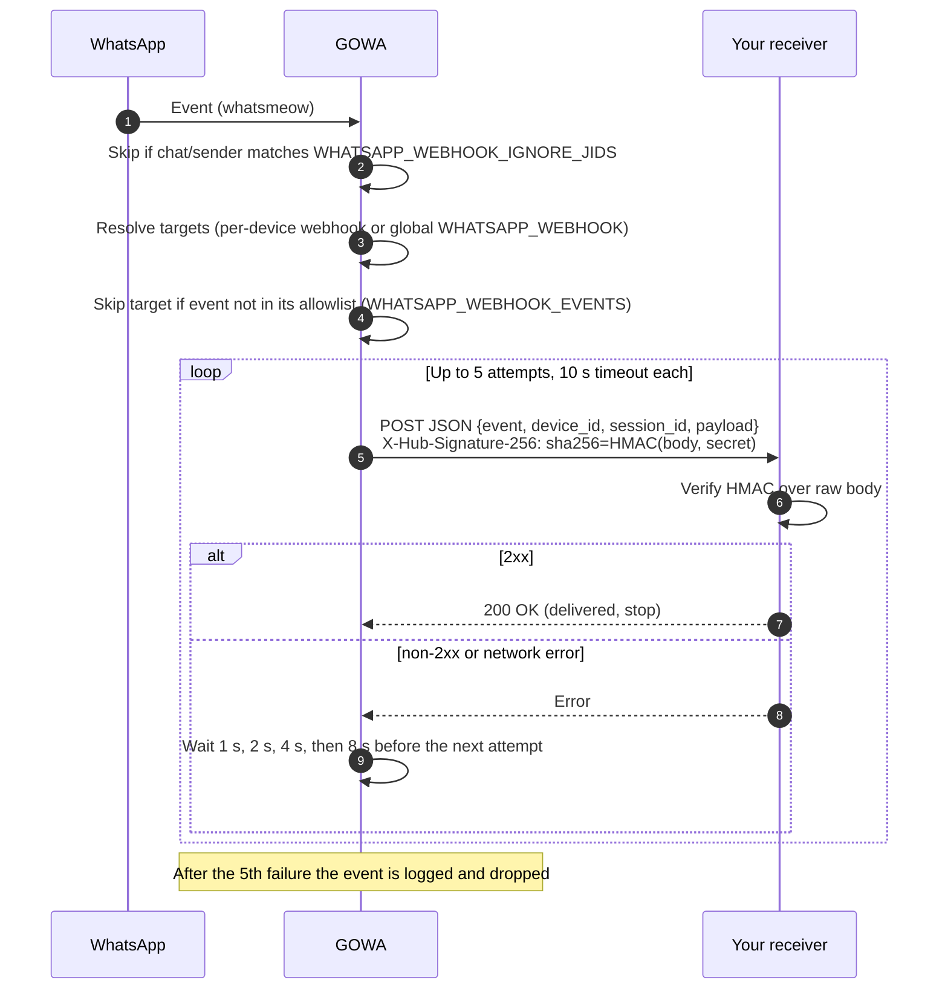
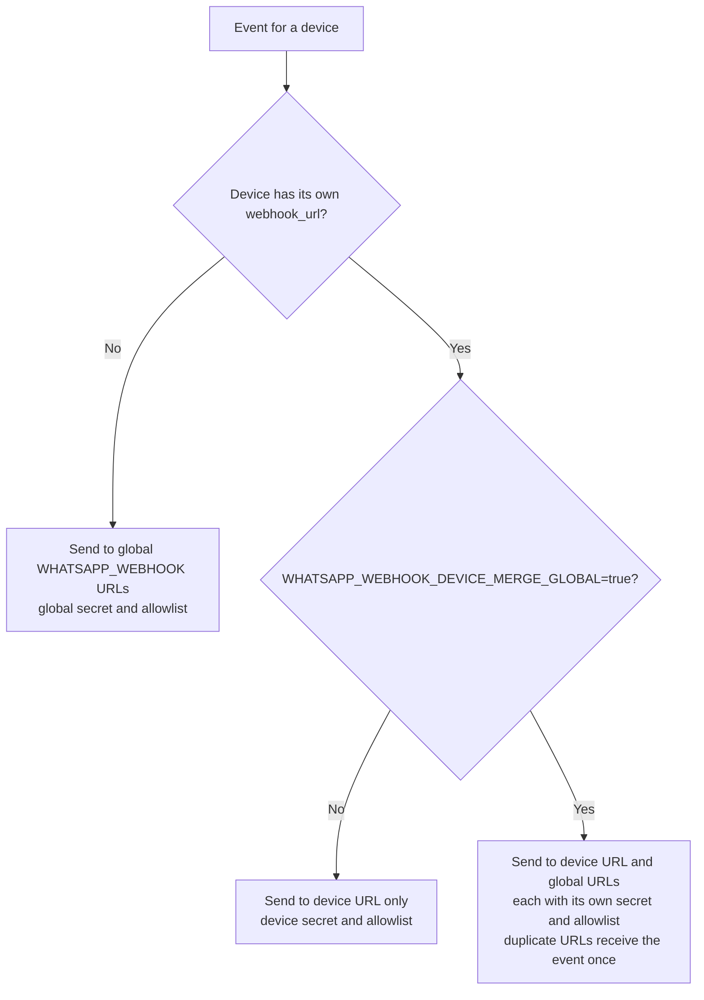

GOWA POSTs a JSON document to your URL for every WhatsApp event it receives: messages, receipts, reactions, edits, deletions, typing indicators, group changes, labels, newsletters and calls.

There is no webhook registration endpoint. Configure webhooks at startup, or per device through `/devices/{device_id}/webhook`.

## How delivery works



Each target URL is delivered independently, with its own secret and retries.

## Configure

```bash
# one or more URLs, comma-separated
WHATSAPP_WEBHOOK=https://example.com/wa-hook,https://backup.example.com/wa-hook
WHATSAPP_WEBHOOK_SECRET=change-me           # HMAC key, default "secret"
WHATSAPP_WEBHOOK_EVENTS=message,message.ack # optional allowlist; empty = all events
WHATSAPP_WEBHOOK_IGNORE_JIDS=@g.us          # optional; skip chats or senders
WHATSAPP_WEBHOOK_INSECURE_SKIP_VERIFY=false # true only for self-signed test endpoints
```

Equivalent flags: `--webhook`, `--webhook-secret`, `--webhook-events`, `--webhook-ignore-jids`, `--webhook-insecure-skip-verify`.

## Events

| Event | Fired when |
| --- | --- |
| `message` | A message arrives (text, media, contact, location, poll, and so on). `is_from_me` is `true` for messages sent by this account. |
| `message.reaction` | Someone reacts to a message. |
| `message.revoked` | A message is deleted for everyone. |
| `message.edited` | A message is edited. |
| `message.ack` | Delivery or read receipt (`receipt_type`: `delivered`, `read`, ...). |
| `message.deleted` | A message is deleted for you only. |
| `chat_presence` | A contact starts or stops typing or recording. |
| `group.participants` | Members join, leave, are promoted or demoted (`type`: `join`, `leave`, `promote`, `demote`). |
| `group.joined` | Your account is added to a group. |
| `label.edit` | A WhatsApp Business label is created or changed. |
| `label.association` | A label is applied to or removed from a chat. |
| `newsletter.joined` / `newsletter.left` | You follow or unfollow a channel. |
| `newsletter.message` | New posts in a followed channel. |
| `newsletter.mute` | A channel's mute setting changes. |
| `call.offer` | Incoming call. With `WHATSAPP_AUTO_REJECT_CALL=true` it is rejected automatically. |

Event names in the allowlist are case-insensitive.

## Payload

Every request has the same envelope:

```json
{
  "event": "message",
  "device_id": "628123456789@s.whatsapp.net",
  "session_id": "sales",
  "payload": {
    "id": "3EB0C127D7BACC83D6A1",
    "chat_id": "628987654321@s.whatsapp.net",
    "from": "628987654321@s.whatsapp.net",
    "from_lid": "251556368777322@lid",
    "from_name": "John Doe",
    "sender_display_name": "John Doe",
    "timestamp": "2026-10-15T10:30:00Z",
    "is_from_me": false,
    "body": "Hello, how are you?"
  }
}
```

| Field | Description |
| --- | --- |
| `event` | One of the event names above. |
| `device_id` | JID of the account that received the event. |
| `session_id` | The slot ID from `POST /devices`. Omitted if the JID cannot be mapped to a slot. Use it to route events per tenant. |
| `payload` | Event-specific data. Common fields: `id`, `chat_id`, `from`, `from_lid`, `from_name`, `sender_display_name`, `timestamp` (RFC 3339), `is_from_me`. |

Replies add `replied_to_id` and `quoted_body`. Receipts use `ids` (array) and `receipt_type`. Group events carry `chat_id`, `type` and `jids`.

### Media

With `WHATSAPP_AUTO_DOWNLOAD_MEDIA=true` (default), media is saved under `statics/media/` and the media field holds the path:

```json
"image": "statics/media/1752404751-ad9e37ac-c658-4fe5-8d25-ba4a3f4d58fd.jpeg"
```

When a caption is present, the field becomes `{"path": "...", "caption": "..."}` and the caption is also in `body`. With auto-download off, it is `{"url": "https://mmg.whatsapp.net/...", "caption": "..."}`; fetch the file later with `GET /message/{message_id}/download?phone=<chat>`.

The full catalogue of payloads (polls, locations, contacts, view-once, ads referrals and more) is in the upstream [webhook payload reference](https://github.com/aldinokemal/go-whatsapp-web-multidevice/blob/main/docs/webhook-payload.md).

## Verify signatures

Each request carries `X-Hub-Signature-256: sha256=<hex>`, an HMAC-SHA256 of the **raw** request body keyed with the webhook secret. Compute it over the exact bytes received, before parsing JSON.

<CodeGroup>

```javascript Node.js (Express)
const express = require("express");
const crypto = require("crypto");
const app = express();
const SECRET = process.env.WEBHOOK_SECRET;

app.post("/wa-hook", express.raw({ type: "application/json" }), (req, res) => {
  const expected = crypto.createHmac("sha256", SECRET).update(req.body).digest("hex");
  const received = (req.get("X-Hub-Signature-256") || "").replace("sha256=", "");
  if (received.length !== expected.length ||
      !crypto.timingSafeEqual(Buffer.from(expected), Buffer.from(received))) {
    return res.sendStatus(401);
  }
  const evt = JSON.parse(req.body);
  res.sendStatus(200);            // acknowledge fast
  handle(evt);                    // then process
});
```

```python Python (Flask)
import hmac, hashlib, os
from flask import Flask, request, abort

app = Flask(__name__)
SECRET = os.environ["WEBHOOK_SECRET"].encode()

@app.post("/wa-hook")
def wa_hook():
    raw = request.get_data()
    expected = hmac.new(SECRET, raw, hashlib.sha256).hexdigest()
    received = request.headers.get("X-Hub-Signature-256", "").removeprefix("sha256=")
    if not hmac.compare_digest(expected, received):
        abort(401)
    evt = request.get_json()
    # enqueue evt for processing
    return "", 200
```

```go Go
func waHook(w http.ResponseWriter, r *http.Request) {
	raw, _ := io.ReadAll(r.Body)
	mac := hmac.New(sha256.New, []byte(os.Getenv("WEBHOOK_SECRET")))
	mac.Write(raw)
	expected := hex.EncodeToString(mac.Sum(nil))
	received := strings.TrimPrefix(r.Header.Get("X-Hub-Signature-256"), "sha256=")
	if !hmac.Equal([]byte(expected), []byte(received)) {
		http.Error(w, "bad signature", http.StatusUnauthorized)
		return
	}
	w.WriteHeader(http.StatusOK)
	// process raw asynchronously
}
```

</CodeGroup>

## Delivery and retries

- Each attempt times out after **10 seconds**.
- Any non-2xx response or network error is retried. GOWA makes up to **5 attempts**, waiting 1 s, 2 s, 4 s and 8 s between them.
- After the last failure the event is dropped and logged. There is no persistent queue or dead-letter store.
- Several URLs are delivered independently.

So: respond `2xx` quickly, process in the background, and make handlers idempotent; a retried event can arrive more than once.

## Filter events

**By type:** `WHATSAPP_WEBHOOK_EVENTS=message,message.ack` forwards only those events.

**By chat or sender:** `WHATSAPP_WEBHOOK_IGNORE_JIDS` matches `chat_id`, `from`, `chat_lid` and `from_lid`. Entries starting with `@` are wildcards for a whole address space (`@g.us`, `@s.whatsapp.net`, `@lid`); anything else is an exact JID.

```bash
# drop all group traffic plus one specific contact
WHATSAPP_WEBHOOK_IGNORE_JIDS=@g.us,628123456789@s.whatsapp.net
```

`@s.whatsapp.net` also matches group messages, because their `from` is a user JID. Use `@g.us` to mute groups. The two filters combine: an event is sent only if its type is allowed **and** its JID is not ignored.

## Per-device webhooks

Give a slot its own webhook, secret and event allowlist:

```bash
curl -u admin:changeme -X PATCH http://localhost:3000/devices/sales/webhook \
  -H "Content-Type: application/json" \
  -d '{
    "webhook_url": "https://sales.example.com/wa-hook",
    "webhook_secret": "sales-secret",
    "webhook_events": "message,message.ack",
    "webhook_insecure_skip_verify": false
  }'
```

The same fields are accepted by `POST /devices`. Read the current setting with `GET /devices/{device_id}/webhook`. Send `"webhook_url": ""` to clear it.



By default a per-device URL **replaces** the global `WHATSAPP_WEBHOOK` for that slot. With `WHATSAPP_WEBHOOK_DEVICE_MERGE_GLOBAL=true` it is **added** to the global URLs instead: the device URL uses the device secret and allowlist, the global URLs keep the global ones, and a URL present in both receives the event once. Ignore-JID rules apply to both.

## Testing locally

Expose a local receiver with a tunnel (for example `ngrok http 8080`) and set `WHATSAPP_WEBHOOK` to the tunnel URL. With `--debug=true`, GOWA logs each delivery attempt and failure.

## Other ways to receive events

- **WebSocket** `/ws?device_id=<id>`: pushes pairing and status events to the dashboard. It is not a substitute for webhooks.
- **Polling:** `GET /chats` and `GET /chat/{chat_jid}/messages` read GOWA's local chat storage. See [Receiving messages](/examples/receiving-messages).
