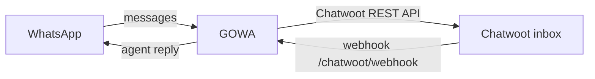

With Chatwoot enabled, GOWA forwards WhatsApp messages (incoming, and outgoing ones sent from the phone) into a Chatwoot **API channel** inbox, and sends agent replies from Chatwoot back to WhatsApp. Text, images, audio, video, documents, stickers, locations and contacts are supported; group chats appear as one conversation per group, with the sender name prefixed.



## Requirements

- GOWA reachable from Chatwoot over a public URL (for agent-reply webhooks).
- A Chatwoot account with admin access and a user API access token.
- At least one logged-in WhatsApp device.

## Set up

<Steps>
  <Step title="Create an API channel inbox">
    In Chatwoot go to **Settings → Inboxes → Add Inbox → API**. Note the numeric **inbox ID** from the inbox URL, and the **webhook secret** Chatwoot shows for the channel. Alternatively, let GOWA create the inbox (see [Auto-provisioning](#auto-provisioning)).
  </Step>
  <Step title="Collect IDs and token">
    The **account ID** is the number in `/app/accounts/<id>/...`. Copy a user **access token** from **Profile Settings**. Both IDs must be the numeric IDs, not the channel `identifier` or `hmac_token`.
  </Step>
  <Step title="Configure GOWA">
    ```bash .env
    CHATWOOT_ENABLED=true
    CHATWOOT_URL=https://chatwoot.example.com
    CHATWOOT_API_TOKEN=your_user_access_token
    CHATWOOT_ACCOUNT_ID=1
    CHATWOOT_INBOX_ID=3
    CHATWOOT_DEVICE_ID=my-device              # required with more than one device
    CHATWOOT_WEBHOOK_SECRET=secret-shown-by-chatwoot
    CHATWOOT_WEBHOOK_URL=https://gowa.example.com/chatwoot/webhook
    ```
    Restart GOWA: the Chatwoot routes are registered at startup.
  </Step>
  <Step title="Point Chatwoot at GOWA">
    Set the API channel's webhook URL to `https://gowa.example.com/chatwoot/webhook` (with `APP_BASE_PATH`, include the base path). This route is public: it is protected by the webhook secret, not Basic Auth.
  </Step>
  <Step title="Test">
    Message the WhatsApp number from another phone; it should appear in the inbox. Reply from Chatwoot and check it arrives on WhatsApp.
  </Step>
</Steps>

## Configuration

| Variable | Default | Description |
|---|---|---|
| `CHATWOOT_ENABLED` | `false` | Master switch. |
| `CHATWOOT_URL` | — | Chatwoot base URL, no trailing slash. |
| `CHATWOOT_API_TOKEN` | — | User API access token. |
| `CHATWOOT_ACCOUNT_ID` | — | Numeric account ID. |
| `CHATWOOT_INBOX_ID` | — | Numeric inbox ID. Optional with `CHATWOOT_AUTO_CREATE=true`; when set it always wins. |
| `CHATWOOT_DEVICE_ID` | — | Device (slot ID or JID) that sends agent replies. Required when more than one device exists. |
| `CHATWOOT_WEBHOOK_URL` | — | Public GOWA webhook URL; used when auto-creating the inbox. |
| `CHATWOOT_WEBHOOK_SECRET` | — | Verifies incoming Chatwoot webhooks. Empty accepts unauthenticated webhooks. |
| `CHATWOOT_WEBHOOK_SIGNATURE_TOLERANCE` | `5m` | Maximum age / clock skew of `X-Chatwoot-Timestamp`. |
| `CHATWOOT_AUTO_CREATE` | `false` | Reuse or create an API inbox named `CHATWOOT_INBOX_NAME` at startup. |
| `CHATWOOT_INBOX_NAME` | `WhatsApp` | Inbox name for auto-provisioning. |
| `CHATWOOT_IMPORT_MESSAGES` | `false` | Import history automatically when a device connects. |
| `CHATWOOT_DAYS_LIMIT_IMPORT_MESSAGES` | `3` | Days of history to import. |
| `CHATWOOT_IMPORT_DB_URI` | — | Chatwoot PostgreSQL URI for direct history import (keeps original timestamps). |
| `CHATWOOT_IMPORT_PLACEHOLDER_MEDIA_MESSAGE` | `true` | Direct import: insert `[image]`-style placeholders for media that cannot be downloaded. |
| `CHATWOOT_IMPORT_MEDIA_WITH_REST` | `false` | Direct import: upload media through the REST API so attachments are created. |
| `CHATWOOT_REOPEN_CONVERSATION` | `true` | Reopen a resolved conversation when the contact writes again. |
| `CHATWOOT_CONVERSATION_PENDING` | `false` | Create new conversations as `pending` instead of `open`. |
| `CHATWOOT_IGNORE_JIDS` | — | Comma-separated JIDs or wildcards (`@g.us`, `@s.whatsapp.net`, `@lid`) never mirrored. |
| `CHATWOOT_SIGN_MSG` | `false` | Prefix agent replies with the agent's name. |
| `CHATWOOT_SIGN_DELIMITER` | `\n\n` | Separator between signature and message. |
| `CHATWOOT_FORWARD_EDITS` | `true` | Mirror WhatsApp edits as private notes. |
| `CHATWOOT_FORWARD_DELETES` | `true` | Mirror delete-for-everyone as private notes. |
| `CHATWOOT_MESSAGE_READ` | `false` | Sync read status both ways. |
| `CHATWOOT_MESSAGE_DELETE` | `false` | Delete the linked message on the other side. |
| `CHATWOOT_ALLOWED_HOSTS` | — | Allowlist of hosts a per-device `chatwoot_url` may target. |

Most settings also have a `--chatwoot-*` flag; `CHATWOOT_URL`, `CHATWOOT_API_TOKEN`, `CHATWOOT_ACCOUNT_ID` and `CHATWOOT_INBOX_ID` are environment-only. See the [configuration reference](/configuration).

## Webhook secret

When `CHATWOOT_WEBHOOK_SECRET` (or a device's `webhook_secret`) is set, every webhook must prove it by one of:

1. **Chatwoot's signature** (`X-Chatwoot-Signature` + `X-Chatwoot-Timestamp`), recommended. Use the API channel's own webhook secret. Replays are rejected.
2. An `X-Hub-Signature-256` HMAC of the body.
3. The secret in an `X-Chatwoot-Webhook-Secret` or `X-Gowa-Chatwoot-Secret` header.
4. `?secret=` in the webhook URL, only for Chatwoot versions that cannot sign or add headers. The secret then appears in access logs.

Failures return `401`; GOWA logs the reason (`signature does not match` = wrong secret, `timestamp outside the tolerance window` = clock drift).

## Auto-provisioning

With `CHATWOOT_AUTO_CREATE=true` and no `CHATWOOT_INBOX_ID`, GOWA looks for an API inbox named `CHATWOOT_INBOX_NAME` at startup and reuses it, or creates one with `CHATWOOT_WEBHOOK_URL` as its webhook.

## One inbox per device

The environment variables configure one destination shared by all devices. To route each device to its own inbox, account or Chatwoot server, store per-device configs (Basic Auth applies):

```bash
curl -u admin:changeme -X PUT http://localhost:3000/devices/sales/chatwoot/config \
  -H "Content-Type: application/json" \
  -d '{
    "chatwoot_url": "https://chatwoot.example.com",
    "account_id": 1,
    "inbox_id": 7,
    "api_token": "token-for-this-inbox",
    "webhook_secret": "secret-of-this-api-channel",
    "enabled": true
  }'
```

The response includes `webhook_url` (`<base>/chatwoot/webhook/<device_id>`); set it as that inbox's webhook. Other routes: `GET /chatwoot/configs`, `GET` and `DELETE /devices/{device_id}/chatwoot/config`.

<Warning>
Once **any** per-device config exists, the `CHATWOOT_*` destination is no longer used as a fallback. Devices without a config are not mirrored.
</Warning>

- `api_token` is stored in GOWA's database and masked in reads; `webhook_secret` is never returned.
- `chatwoot_url` must be `http(s)`, without credentials, and must not resolve to private or loopback addresses. Restrict it further with `CHATWOOT_ALLOWED_HOSTS`.
- Changing `chatwoot_url`, `account_id` or `inbox_id` after conversations are linked returns `409`; delete and recreate the config instead.
- A config can be created before the device pairs.
- Direct database import works only in single (environment) config mode.

## Import history

```bash
curl -u admin:changeme -X POST http://localhost:3000/chatwoot/sync \
  -H "Content-Type: application/json" \
  -d '{"device_id": "my-device", "days_limit": 7, "include_media": true, "include_groups": true}'

curl -u admin:changeme "http://localhost:3000/chatwoot/sync/status?device_id=my-device"
```

Defaults: `days_limit` 3, `include_media` true, `include_groups` true. The sync reads GOWA's local chat storage, runs in the background, and only one sync per device can run at a time. Media older than about two weeks may no longer be downloadable from WhatsApp.

The REST path cannot set original timestamps; imported messages get the import time. For self-hosted Chatwoot, `CHATWOOT_IMPORT_DB_URI` writes directly to Chatwoot's PostgreSQL and preserves them.

## Delivery and retries

Live messages that hit a transient Chatwoot error (network error, HTTP 429 or 5xx) are queued in local storage and retried in the background with capped exponential backoff. Other 4xx errors are logged and dropped.

## Troubleshooting

| Symptom | Check |
|---|---|
| Agent replies not delivered | `CHATWOOT_DEVICE_ID` set and device logged in; webhook URL correct and public; `DEVICE_NOT_AVAILABLE` in logs means no usable device. |
| `401` on `/chatwoot/webhook` | Secret mismatch or clock drift (see above). |
| WhatsApp messages not in Chatwoot | `CHATWOOT_ENABLED=true`; token valid; numeric account and inbox IDs; GOWA can reach `CHATWOOT_URL`. |
| `CHATWOOT_NOT_CONFIGURED` | URL, token, account ID or inbox ID missing. |

Run with `APP_DEBUG=true` and look for log lines starting with `Chatwoot:` and `Chatwoot Webhook:`. The upstream [Chatwoot guide](https://github.com/aldinokemal/go-whatsapp-web-multidevice/blob/main/docs/chatwoot.md) covers direct database import and formatting rules in more depth.
